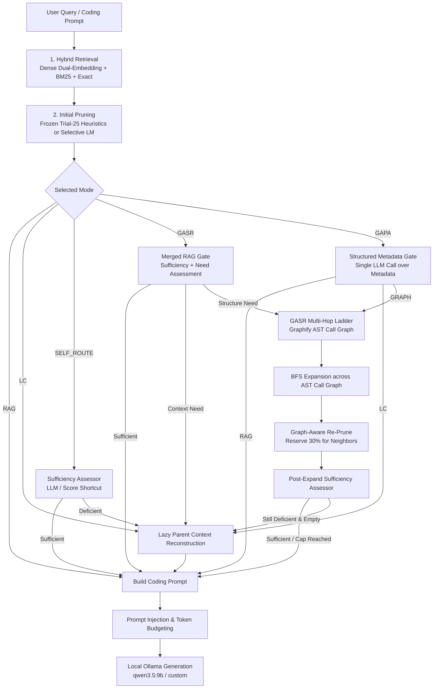

# Adaptive Context Engineering System

> **A Multi-Tier Context Engineering Platform for LLM-Assisted Code Intelligence**  
> Incorporating **Graph-Augmented Sufficiency Routing (GASR)**, **GAPA Fast Gating**, **Dual Embeddings ($v_{code} + v_{meta}$)**, **Structure-Aware Pruning**, **Lazy Parent Context**, and a dedicated **VS Code Extension Agent**.

[](https://github.com/reffobic/context-engineering-thesis/actions/workflows/test.yml)
[](https://www.python.org/downloads/)
[](https://fastapi.tiangolo.com/)
[](https://www.trychroma.com/)
[](file:///Users/refobic/Documents/Thesis2/Context-Engineering-Thesis1/vscode-extension)

---

## Table of Contents

1. [System Overview & Architecture](#system-overview--architecture)
2. [Pipeline Execution Modes](#pipeline-execution-modes)
   - [SELF_ROUTE (Auto-Route with LLM Sufficiency Judge)](#1-self_route-auto-route-with-llm-sufficiency-judge)
   - [GASR (Graph-Augmented Sufficiency Routing)](#2-gasr-graph-augmented-sufficiency-routing)
   - [GAPA (Fast Structured Metadata Gate)](#3-gapa-fast-structured-metadata-gate)
   - [Standard RAG & Long Context (LC)](#4-standard-rag--long-context-lc)
3. [Key Subsystems & Engineering Innovations](#key-subsystems--engineering-innovations)
   - [Incremental & Idempotent Indexing](#incremental--idempotent-indexing)
   - [Contextual Dual Embeddings ($v_{code} + v_{meta}$)](#contextual-dual-embeddings-v_code--v_meta)
   - [Hybrid Retrieval with Lazy Parent Context](#hybrid-retrieval-with-lazy-parent-context)
   - [Structure-Aware Pruning (Heuristic & Selective)](#structure-aware-pruning-heuristic--selective)
   - [AST Call Graph Integration (Graphify)](#ast-call-graph-integration-graphify)
   - [Context Metrics & Ollama Evaluation Suite](#context-metrics--ollama-evaluation-suite)
4. [VS Code Extension (`context-engine`)](#vs-code-extension-context-engine)
5. [Repository Structure](#repository-structure)
6. [Installation & Setup](#installation--setup)
7. [Running the System](#running-the-system)
   - [Starting the FastAPI Backend](#starting-the-fastapi-backend)
   - [Accessing the Web Dashboard UI (`/ui`)](#accessing-the-web-dashboard-ui-ui)
   - [Launching the VS Code Extension](#launching-the-vs-code-extension)
   - [CLI Demo Client](#cli-demo-client)
8. [HTTP & Streaming API Reference](#http--streaming-api-reference)
9. [Testing & Quality Assurance](#testing--quality-assurance)
10. [Environment Variables & Configuration](#environment-variables--configuration)
11. [Failure Modes & Graceful Fallbacks](#failure-modes--graceful-fallbacks)
12. [Troubleshooting Guide](#troubleshooting-guide)

---

## System Overview & Architecture

Modern LLM-assisted programming assistants face a fundamental trade-off: **Standard Retrieval-Augmented Generation (RAG)** provides pinpoint code fragments but often lacks structural dependencies (callers, callees, class hierarchies), while **Long-Context (LC)** window stuffing guarantees global context at the cost of extreme token waste, distraction ("lost-in-the-middle"), and latency.

This repository implements an **Adaptive Context Engineering System** that bridges this gap. It evaluates the sufficiency of retrieved code dynamically and escalates through an intelligent multi-hop ladder—augmenting context with static call-graph neighbors before falling back to full file contexts.



### Core Architecture Highlights

- **FastAPI REST API**: High-performance backend orchestrating pipeline stages ([`server.py`](file:///Users/refobic/Documents/Thesis2/Context-Engineering-Thesis1/backend/mcp_server/server.py)).  
  > [!NOTE]  
  > Despite the historical package directory name `backend/mcp_server/`, the server is a standard **FastAPI REST & SSE** service with an internal Python tool registry ([`tool_registry.py`](file:///Users/refobic/Documents/Thesis2/Context-Engineering-Thesis1/backend/mcp_server/tool_registry.py)), *not* an Anthropic JSON-RPC MCP server.
- **Local Ollama Integration**: Zero external API dependencies; defaults to [`qwen3.5:9b`](file:///Users/refobic/Documents/Thesis2/Context-Engineering-Thesis1/backend/agent/agent_endpoint.py) for generation and assessor evaluation.
- **Dual Vector Store**: ChromaDB with cosine distance indexing code implementations in `code_embeddings` and natural-language situating headers in `code_meta_embeddings`.
- **Static Call Graph (Graphify)**: Deterministic code dependency graphs (`graph.json`) providing AST-level caller/callee traversal without generative hallucinations.

---

## Pipeline Execution Modes

The backend supports 5 pipeline execution modes selectable via the API (`POST /generate`, `POST /generate/stream`) or the VS Code extension:

### 1. `SELF_ROUTE` (Auto-Route with LLM Sufficiency Judge)
- Evaluates whether the retrieved and pruned RAG context is sufficient to answer the user query.
- Implemented in [`backend/diamond/sufficiency_assessor.py`](file:///Users/refobic/Documents/Thesis2/Context-Engineering-Thesis1/backend/diamond/sufficiency_assessor.py).
- Features a **score shortcut threshold**: if top chunk similarity $\ge 0.88$, it immediately marks context as sufficient without invoking an LLM.
- If insufficient, it escalates directly to **Long Context (LC)** via lazy parent file reconstruction.

### 2. `GASR` (Graph-Augmented Sufficiency Routing)
- Multi-hop ladder implemented in [`backend/diamond/gasr_ladder.py`](file:///Users/refobic/Documents/Thesis2/Context-Engineering-Thesis1/backend/diamond/gasr_ladder.py).
- **Merged Post-RAG Gate** ([`assess_rag_gate`](file:///Users/refobic/Documents/Thesis2/Context-Engineering-Thesis1/backend/diamond/sufficiency_assessor.py)): evaluates both sufficiency and the underlying deficiency need (`STRUCTURE` vs `CONTEXT`) in a single prompt.
- **Sticky Need Policy**: once `STRUCTURE` need is determined, subsequent hops do not re-query structure need.
- **Seed Pool Curation** ([`backend/diamond/gasr_seeds.py`](file:///Users/refobic/Documents/Thesis2/Context-Engineering-Thesis1/backend/diamond/gasr_seeds.py)): filters out test fixtures and noise so BFS expansions target core business logic.
- **BFS Call Graph Expansion** ([`backend/retrieval/graph_expand.py`](file:///Users/refobic/Documents/Thesis2/Context-Engineering-Thesis1/backend/retrieval/graph_expand.py)): traverses callers, callees, and imports up to `GASR_HARD_CAP` hops (default: 2) with a bounded neighbor count (default: 8).
- **Graph-Aware Re-Pruning** ([`prune_context_graph_aware`](file:///Users/refobic/Documents/Thesis2/Context-Engineering-Thesis1/backend/pruning/file.py)): guarantees that expanded graph neighbors receive dedicated token allocation (default: 30%) alongside original seed chunks.
- **Graceful LC Fallback**: falls through to LC if graph expansion discovers zero new chunks or if `graph.json` is missing.

### 3. `GAPA` (Fast Structured Metadata Gate)
- Low-latency entry gate in [`backend/diamond/preroute_gate.py`](file:///Users/refobic/Documents/Thesis2/Context-Engineering-Thesis1/backend/diamond/preroute_gate.py).
- Executes a **single-call structured prompt** (`preroute_structured_gate`) evaluated strictly over raw retrieval **metadata** (file paths, symbols, chunk types, scores) without injecting full chunk bodies.
- Bypasses raw code reading during gating, then invokes downstream GASR graph expansion if structural expansion is needed.
- Note: Replaces the deprecated `PREROUTE` parameter (which now returns HTTP 422).

### 4. Standard `RAG` & Long Context (`LC`)
- **`RAG`**: Direct hybrid retrieval $\rightarrow$ structure-aware pruning $\rightarrow$ prompt injection. Skips sufficiency assessment.
- **`LC`**: Reconstructs complete parent source files around retrieved chunks using cached database lookups ([`reconstruct_file_context`](file:///Users/refobic/Documents/Thesis2/Context-Engineering-Thesis1/backend/retrieval/retrieval_tool.py#L914)), providing maximum surrounding context for complex refactorings.

---

## Key Subsystems & Engineering Innovations

### Incremental & Idempotent Indexing
Located in [`backend/indexing/code_indexer.py`](file:///Users/refobic/Documents/Thesis2/Context-Engineering-Thesis1/backend/indexing/code_indexer.py):
- **Incremental Cache**: Maintains file hashes in `.index_cache.json` under `INDEX_SCHEMA_VERSION = "contextual-dual-v1"`. Unmodified files are skipped completely, ensuring fast subsequent runs.
- **AST Chunking with Resilient Fallback**: Python files are decomposed into semantic AST units (functions, classes, async definitions). If syntax errors exist (or for non-Python languages like TS, JS, Go, Java), the indexer falls back gracefully to `_chunk_generic` without dropping the file.
- **Encoding & Minification Defense**: Reads source files with `errors="replace"` and handles UTF-8 BOM, Latin-1, CRLF, and UTF-16. Giant single-line minified files are bounded by `MAX_CHUNK_TOKENS * 6` characters to prevent OOM errors.

### Contextual Dual Embeddings ($v_{code} + v_{meta}$)
Each code chunk produces two representations embedded with `all-MiniLM-L6-v2`:
1. **$v_{code}$ (`code_embeddings`)**: Dense vector of raw source code for syntactic and semantic code similarity.
2. **$v_{meta}$ (`code_meta_embeddings`)**: Dense vector of Anthropic-style natural language situating headers (file location, purpose, qualified symbol name, dependencies) capped at 700 characters (`SITUATING_MAX_CHARS`).

At query time, dense similarity is calculated as:
$$\text{Score}_{dense} = (1 - \alpha) \cdot \text{sim}_{code} + \alpha \cdot \text{sim}_{meta}$$
Default: $\alpha = 0.40$ (`DENSE_ALPHA`).

### Hybrid Retrieval with Lazy Parent Context
Located in [`backend/retrieval/retrieval_tool.py`](file:///Users/refobic/Documents/Thesis2/Context-Engineering-Thesis1/backend/retrieval/retrieval_tool.py):
- Multi-stream ranking combining:
  - Dense dual-embedding cosine similarity ($W_{dense} = 0.361$)
  - BM25Okapi keyword scoring ($W_{bm25} = 0.303$)
  - Exact phrase and C-style symbol matches ($W_{exact} = 0.124, W_{keyword} = 0.095$)
  - Path matches & class definitions ($W_{path} = 0.205, W_{class} = 0.142$)
  - Source file boost ($W_{source} = 0.105$)
- **Lazy Parent Context**: Sibling chunk stitching across whole files is deferred until the LC route is actively selected, saving significant database overhead on RAG and GASR requests.

### Structure-Aware Pruning (Heuristic & Selective)
Located in [`backend/pruning/file.py`](file:///Users/refobic/Documents/Thesis2/Context-Engineering-Thesis1/backend/pruning/file.py):
- **Frozen Trial-25 Heuristic Defaults**: Calibrated weights that rank retrieved chunks within the strict token budget (default: 1800 tokens):
  - Retrieval Score: `0.77419` (`PRUNE_W_RETRIEVAL`)
  - Query Match: `0.28873` (`PRUNE_W_QUERY_MATCH`)
  - Function Definition: `0.82476` (`PRUNE_W_FUNCTION`)
  - Structural Position: `0.42360` (`PRUNE_W_STRUCTURE`)
- **Selective Context Pruning**: Optional token-level self-information pruning ([`selective_context.py`](file:///Users/refobic/Documents/Thesis2/Context-Engineering-Thesis1/backend/pruning/selective_context.py)) using `Salesforce/codegen-350M-multi`. Automatically falls back to heuristic pruning when offline or without GPU.
- **Graph-Aware Re-Prune**: In GASR, seeds and neighbors are partitioned, reserving 30% of the token budget (`GASR_NEIGHBOR_BUDGET_FRACTION`) specifically for graph neighbors.

### AST Call Graph Integration (Graphify)
- Adapts Graphify call graphs ([`backend/indexing/graphify_adapter.py`](file:///Users/refobic/Documents/Thesis2/Context-Engineering-Thesis1/backend/indexing/graphify_adapter.py)).
- Inspects `graphify-out/graph.json` to extract callers, callees, definitions, and file links.
- Interactive D3 visualization served at `/graphify-view`.

### Context Metrics & Ollama Evaluation Suite
Located in [`backend/context_metrics/`](file:///Users/refobic/Documents/Thesis2/Context-Engineering-Thesis1/backend/context_metrics/):
- Automated evaluation via `POST /evaluate`.
- Calculates precision, recall, hit rate, and MRR against ground-truth files.
- Evaluates DeepEval **Contextual Relevancy** and **Faithfulness** using a local Ollama judge ([`ollama_judge.py`](file:///Users/refobic/Documents/Thesis2/Context-Engineering-Thesis1/backend/context_metrics/ollama_judge.py)).
- Automatically saves timestamped evaluation results to `results/{retrieval_mode}/json/eval-*.json`.

---

## VS Code Extension (`context-engine`)

The project includes a production-grade VS Code extension (v0.2.1) providing an interactive coding assistant in the sidebar.

```
vscode-extension/
├── package.json          # Extension manifest, commands, settings, activation
├── src/
│   ├── extension.ts      # Lifecycle, process spawning, port checks, Ollama preflight
│   └── sidebarProvider.ts# Webview HTML generator, message router, workspace bridge
└── webview/
    ├── main.js           # UI logic, SSE streaming reader, model manager, state
    └── style.css         # Modern dark theme matching VS Code / Cursor aesthetics
```

### Key Extension Features

1. **Live Animated Pipeline Progression**:
   - Visual step-by-step pipeline tracker: *Retrieve $\rightarrow$ Prune $\rightarrow$ Assess $\rightarrow$ Graph Expand $\rightarrow$ Re-Prune $\rightarrow$ Inject $\rightarrow$ Generate*.
   - Expandable stage diagnostics showing execution duration (ms), chunk counts, token estimations, and routing decisions.
2. **Real-Time Token Streaming (SSE)**:
   - Streams LLM output via `POST /generate/stream` using Server-Sent Events, rendering markdown and syntax-highlighted code blocks dynamically.
3. **Dual Model Management**:
   - Independent model selectors for the **Primary Generator** (e.g. `qwen3.5:9b`) and the **Assessor Gate** (e.g. `qwen3.5:4b` or `llama3.2:3b`).
   - Auto-discovers installed Ollama models via `GET /models` and allows adding custom model tags.
4. **Context Retrieval Scopes**:
   - `@codebase`: Global hybrid retrieval + graph expansion across the workspace.
   - `File only`: Automatically extracts the active editor's contents and injects them directly into the context window (`file_context`), short-circuiting retrieval.
5. **Context Chips**:
   - One-click context insertion for active files, functions, or editor selections.
6. **Robust Process Hygiene & Preflight Checks**:
   - **Port Collision Check**: Probes `127.0.0.1:<port>` before spawning a server; prompts to connect to existing or change ports.
   - **Ollama Reachability Check**: Queries `http://localhost:11434/api/tags` with non-blocking warnings if Ollama is offline.
   - **Status Bar Integration**: Real-time status indicator showing backend connection and indexing progress (`$(sync~spin)`).

### Extension Settings (`settings.json`)

| Setting | Default | Description |
|---|---|---|
| `contextEngine.backendPort` | `8000` | Local port used by the Context Engine backend service (`127.0.0.1`). |
| `contextEngine.pythonPath` | `python` | Path to the Python interpreter used to launch the backend service. |
| `contextEngine.defaultModel` | `qwen3.5:9b` | Default Ollama model used for code synthesis and answers. |
| `contextEngine.autoStartServer` | `false` | Automatically launch the local backend service when opening a workspace. |

---

## Repository Structure

```
Context-Engineering-Thesis1/
├── pyproject.toml                     # PEP 517 build, dependencies, pytest configuration
├── requirements.txt                   # Baseline dependencies
├── README.md                          # Comprehensive project documentation
├── TESTCASES.md                       # Manual verification testcases (TC-01 to TC-18)
├── RETRIEVAL_RESOURCES.md             # Theoretical retrieval literature references
├── .github/
│   └── workflows/
│       └── test.yml                   # GitHub Actions CI for Backend & VS Code extension
├── docs/
│   ├── ARCHITECTURE_AND_FAILURE_MODES.md # Detailed architectural notes and failure modes
│   └── GASR_LIVE_RUN.md               # Guide for executing live GASR evaluation runs
├── backend/
│   ├── smoke_test.py                  # Tier A & B integration smoke tests
│   ├── mcp_server/
│   │   ├── server.py                  # FastAPI server: /generate, /generate/stream, /index, /evaluate
│   │   ├── tool_registry.py           # Tool dispatch registry
│   │   ├── run_demo.py                # Interactive CLI demo client
│   │   └── static/
│   │       ├── index.html             # Web dashboard UI
│   │       └── graphify_view.html     # Graph visualizer UI
│   ├── diamond/                       # GASR & GAPA routing logic
│   │   ├── gasr_ladder.py             # Multi-hop RAG -> GRAPH -> LC state machine
│   │   ├── gasr_seeds.py              # Non-test seed filtering
│   │   ├── preroute_gate.py           # GAPA single-call structured metadata gate
│   │   ├── sufficiency_assessor.py    # LLM sufficiency assessor & merged rag_gate
│   │   └── test_preroute_gate.py      # Unit tests for GAPA gate logic
│   ├── indexing/
│   │   ├── code_indexer.py            # AST chunking, dual embeddings, caching
│   │   ├── code_indexer_endpoint.py   # Tool bindings (index_codebase, get_index_summary)
│   │   ├── sentence_model.py          # Shared SentenceTransformer singleton
│   │   ├── graph_builder.py           # Call graph builder
│   │   ├── graph_embeddings.py        # Hybrid embedding manager
│   │   └── graphify_adapter.py        # Adapter for Graphify graph.json
│   ├── retrieval/
│   │   ├── retrieval_tool.py          # Multi-stream hybrid retrieval & lazy parent context
│   │   ├── retrieval_tool_endpoint.py # retrieve_context tool binding
│   │   ├── graph_expand.py            # BFS neighbor expander for GASR
│   │   └── hybrid_retrieval.py        # Structural re-ranking extensions
│   ├── pruning/
│   │   ├── file.py                    # Structure-aware & graph-aware pruner (Trial-25 weights)
│   │   ├── pruning_tool_endpoint.py   # prune_context tool binding
│   │   └── selective_context.py       # Selective context (causal LM self-information)
│   ├── injection/
│   │   ├── prompt_builder.py          # Structured ContextChunk formatting & token budgets
│   │   ├── prompt_builder_endpoint.py # inject_context tool binding
│   │   └── chunk_normalize.py         # Line numbering normalizer
│   ├── agent/
│   │   ├── ollama_agent.py            # HTTP client for Ollama /api/chat and /api/generate
│   │   └── agent_endpoint.py          # ollama_generate tool binding
│   └── context_metrics/
│       ├── run_pipeline_metrics.py    # Offline metric computations (P/R/MRR/compression)
│       └── ollama_judge.py            # Local Ollama judge for DeepEval metrics
├── vscode-extension/                  # VS Code Extension
│   ├── package.json                   # Extension manifest & commands
│   ├── tsconfig.json                  # TypeScript compiler settings
│   ├── src/                           # Host extension code (extension.ts, sidebarProvider.ts)
│   └── webview/                       # Sidebar frontend (main.js, style.css)
├── tests/
│   └── backend/
│       ├── test_indexing_robustness.py   # Syntax fallback, binary files, encodings
│       ├── test_indexing_idempotency.py  # Cache reuse, single-file updates, caps
│       ├── test_contextual_embeddings.py # Dual-embedding shape & metadata contracts
│       ├── test_pruning.py               # Token budgets, monster chunks, selective fallback
│       ├── test_gasr_ladder.py           # Multi-hop ladder, merged gates, LC fallback
│       └── test_api_contract.py          # FastAPI contract, 422 validations, mocked 200s
├── scripts/                           # Live experiment & evaluation runners
│   ├── live_gasr_ollama_tests.py      # Automated 5-case thesis test runner against live Ollama
│   ├── live_modes_compare_suite.py    # Latency/token/route comparison across 5 modes
│   ├── live_modes_quality_compare.py  # Head-to-head answer quality benchmark
│   ├── score_answer_quality.py        # Automated answer scoring
│   └── token_usage_report.py          # Token usage and prompt efficiency reporting
└── results/                           # Evaluation logs and metric JSON dumps
```

---

## Installation & Setup

### Prerequisites
- **Python**: 3.10+ (tested on Python 3.10, 3.12, 3.14).
- **Node.js**: 18+ or 20+ (for compiling the VS Code extension).
- **Ollama**: Installed and running on host (`http://127.0.0.1:11434`).
- **Graphify** (optional, for call graph expansion): `pip install -U graphifyy`.

### 1. Python Environment Setup

Clone the repository and install dependencies in editable mode:

```bash
cd Context-Engineering-Thesis1
python3 -m venv .venv
source .venv/bin/activate

# Install backend dependencies with test packages
pip install --upgrade pip
pip install -e ".[test]"
```

Pre-cache the default embedding model (`all-MiniLM-L6-v2`):

```bash
python3 -c "from sentence_transformers import SentenceTransformer; SentenceTransformer('all-MiniLM-L6-v2')"
```

### 2. Ollama Setup

Start the Ollama daemon and pull the recommended models:

```bash
# Start Ollama service (if not running)
ollama serve

# Pull default primary generation model
ollama pull qwen3.5:9b

# (Optional) Pull fast model for gating and sufficiency assessment
ollama pull qwen3.5:4b
# or:
ollama pull llama3.2:3b
```

### 3. Build Code Call Graph (`graph.json`)

To enable GASR graph expansion hops, build the static AST call graph:

```bash
# Run Graphify over your codebase
python3 -m pip install -U graphifyy
graphify update . --force

# Verify graph output
ls -la graphify-out/graph.json
```

---

## Running the System

### Starting the FastAPI Backend

Run the server from repository root with `uvicorn`:

```bash
# Option A: From repository root (recommended)
uvicorn backend.mcp_server.server:app --reload --host 127.0.0.1 --port 8000

# Option B: From backend/ directory
cd backend
python3 -m uvicorn mcp_server.server:app --reload --host 127.0.0.1 --port 8000
```

Verify backend health:

```bash
curl -s http://127.0.0.1:8000/
# Output: {"message":"Context Engine Running","ui":"/ui"}
```

### Accessing the Web Dashboard UI (`/ui`)

Open your browser at:
```
http://127.0.0.1:8000/ui
```
The web dashboard provides:
- One-click codebase indexing with file/chunk summary displays.
- Pipeline execution with live stage duration and token preview metrics.
- Collapsible inspectable raw pipeline JSON and model output.

### Launching the VS Code Extension

1. Navigate to the extension directory:
   ```bash
   cd vscode-extension
   npm install
   npm run compile
   ```
2. Open the project in VS Code:
   ```bash
   code .
   ```
3. Press **F5** to open the **Extension Development Host**.
4. In the Activity Bar, click the **Context Engine** icon (`media/icons/context-engine.svg`).
5. Click **Start Engine** to auto-launch the backend, or connect directly to an already running instance.
6. Click the **Index Workspace** (`$(database)`) button to index the repository.

### CLI Demo Client

Run queries from your terminal without opening a browser or editor:

```bash
cd backend
python3 mcp_server/run_demo.py
```

---

## HTTP & Streaming API Reference

Base URL: `http://127.0.0.1:8000`

### Summary of Endpoints

| Method | Endpoint | Description |
|---|---|---|
| `GET` | `/` | Health check and UI link |
| `GET` | `/ui` | Serves dashboard web application |
| `GET` | `/models` | Proxies Ollama `/api/tags` to list installed models |
| `GET` | `/index/summary` | Returns chunk and file count metrics for the index |
| `GET` | `/graphify-view` | Serves interactive D3 call graph visualization |
| `POST` | `/index` | Triggers codebase indexing into ChromaDB (query parameters) |
| `POST` | `/generate` | Executes the complete pipeline synchronously |
| `POST` | `/generate/stream` | Server-Sent Events (SSE) streaming pipeline |
| `POST` | `/evaluate` | Benchmarks retrieval quality and runs DeepEval evaluation |

---

### Detailed Endpoint Specifications

#### `POST /generate`
Synchronous end-to-end pipeline run.

**Request Body (`application/json`)**:
```json
{
  "prompt": "How does the cache warmup task work in superset?",
  "mode": "GASR",
  "pruning_method": "heuristic",
  "model": "qwen3.5:9b",
  "assessor_model": "qwen3.5:4b"
}
```
*Valid `mode` values*: `"GASR"`, `"GAPA"`, `"SELF_ROUTE"`, `"RAG"`, `"LC"`.  
*Valid `pruning_method` values*: `"heuristic"`, `"selective"`.

**Response Body**:
```json
{
  "output": "The cache warmup task in Superset is defined in ...",
  "route": "GRAPH",
  "tokens_injected_est": 1640,
  "pipeline": {
    "prompt": "How does the cache warmup task work in superset?",
    "mode": "GASR",
    "route": "GRAPH",
    "hops_used": 1,
    "stages": {
      "retrieve": { "duration_ms": 45, "summary": { "chunks_retrieved": 20 } },
      "prune": { "duration_ms": 12, "summary": { "kept_chunks": 5 } },
      "assess": { "duration_ms": 820, "summary": { "route": "GRAPH", "hops_used": 1 } },
      "graph_expand": { "duration_ms": 35, "summary": { "new_chunks": 4 } },
      "re_prune": { "duration_ms": 8, "summary": { "kept": 7 } },
      "inject": { "duration_ms": 3, "summary": { "estimated_tokens": 1640 } },
      "generate": { "duration_ms": 2450, "summary": { "output_chars": 1280 } }
    }
  }
}
```

---

#### `POST /generate/stream`
Server-Sent Events (SSE) endpoint powering the VS Code extension.

**Request Body**:
```json
{
  "prompt": "Explain the role of SecurityManager in superset",
  "mode": "GASR",
  "model": "qwen3.5:9b",
  "assessor_model": "qwen3.5:4b",
  "file_context": null,
  "pruning_method": "heuristic"
}
```

**Streamed SSE Frame Types**:
- `{"event": "stage_start", "stage": "retrieve", "label": "Retrieve context"}`
- `{"event": "stage", "stage": "retrieve", "status": "complete", "duration_ms": 42, "summary": {...}}`
- `{"event": "token", "token": "The"}`
- `{"event": "token", "token": " Security"}`
- `{"event": "done", "output": "...", "pipeline": {...}}`

---

#### `POST /index`
Indexes a target repository into ChromaDB.

**Query Parameters**:
- `repo_path` *(string, optional)*: Absolute path to the repository root. Defaults to `backend/flask_test`.
- `languages` *(list[string], optional)*: Filters by languages (e.g. `python`, `typescript`).
- `include_dirs` *(list[string], optional)*: Restricts indexing to specific subdirectories.
- `max_files` *(int, default: 600)*: Maximum number of files to process per batch. Set to `10000` to index entire large repos.
- `rebuild_bm25` *(bool, default: false)*: Force-rebuilds the BM25 index from scratch.

---

#### `POST /evaluate`
Evaluates context relevance, pruning retention, and faithfulness.

**Request Body**:
```json
{
  "prompt": "Where is the Flask app factory initialized?",
  "top_k": 10,
  "token_budget": 1800,
  "relevant_files": ["superset/app.py", "superset/initialization/__init__.py"],
  "judge_retrieval_relevancy": true,
  "faithfulness": true,
  "generate_mode": "GASR",
  "retrieval_mode": "hybrid",
  "save_metrics_json": true
}
```
Outputs precision, recall, hit rate, MRR, DeepEval scores, and persists results to `results/hybrid/json/eval-*.json`.

---

## Testing & Quality Assurance

The codebase features an exhaustive, multi-tiered test suite with strict offline guarantees.

```
       [Tier 4: Live Ollama Baseline]      -> scripts/live_gasr_ollama_tests.py
                   ▲
       [Tier 3: Smoke Integration]         -> backend/smoke_test.py (Tier A & B)
                   ▲
       [Tier 2: Offline Mocked Contracts]  -> tests/backend/test_api_contract.py, etc.
                   ▲
       [Tier 1: Offline Unit Invariants]   -> tests/backend/test_indexing_robustness.py, etc.
```

### Running Offline Tests (Tiers 1 & 2)

Run with `pytest`:

```bash
# Run all Tier 1 and Tier 2 offline tests
pytest tests/backend backend/diamond/test_preroute_gate.py -v
```

#### Test Suite Breakdown

1. **Tier 1: Unit & Robustness Invariants**:
   - [`test_indexing_robustness.py`](file:///Users/refobic/Documents/Thesis2/Context-Engineering-Thesis1/tests/backend/test_indexing_robustness.py): Python syntax error fallback to generic chunker; binary file resilience; Latin-1, CRLF, UTF-8 BOM, UTF-16 encodings; minified single-line file bounding.
   - [`test_contextual_embeddings.py`](file:///Users/refobic/Documents/Thesis2/Context-Engineering-Thesis1/tests/backend/test_contextual_embeddings.py): Dual-embedding contracts ($v_{code}$ vs $v_{meta}$), Anthropic situating header limits, schema versions.
   - [`test_pruning.py`](file:///Users/refobic/Documents/Thesis2/Context-Engineering-Thesis1/tests/backend/test_pruning.py): Strict budget invariants (`token_budget=1800`, `token_budget=0`), empty inputs, giant chunk handling, frozen Trial-25 weight scoring.
   - [`test_preroute_gate.py`](file:///Users/refobic/Documents/Thesis2/Context-Engineering-Thesis1/backend/diamond/test_preroute_gate.py): GAPA stage-1 keywords, stage-2 scoring rules, and structured metadata prompt validation.
2. **Tier 2: Offline Contracts & State Machines**:
   - [`test_gasr_ladder.py`](file:///Users/refobic/Documents/Thesis2/Context-Engineering-Thesis1/tests/backend/test_gasr_ladder.py): Full GASR state machine verification: merged gate path, sticky structure need, missing `graph.json` fallback to LC, hard cap enforcement.
   - [`test_indexing_idempotency.py`](file:///Users/refobic/Documents/Thesis2/Context-Engineering-Thesis1/tests/backend/test_indexing_idempotency.py): Incremental caching: second indexing pass skips unchanged files (`chunks_added == 0`); single-file edits re-index only that file.
   - [`test_api_contract.py`](file:///Users/refobic/Documents/Thesis2/Context-Engineering-Thesis1/tests/backend/test_api_contract.py): FastAPI schema validation (422s on missing fields or removed `PREROUTE` mode), mocked 200 pipeline flows (`GASR`, `GAPA`, `SELF_ROUTE`, `RAG`, `LC`), graceful offline Ollama response (`GET /models`).
3. **Tier 3: Integration Smoke Tests**:
   - [`backend/smoke_test.py`](file:///Users/refobic/Documents/Thesis2/Context-Engineering-Thesis1/backend/smoke_test.py): Tier A checks prompt formatting; Tier B tests live FastAPI endpoints.
4. **Tier 4: Live Ollama Baseline**:
   - Run the automated 5-query thesis benchmark against a running Ollama instance:
     ```bash
     python3 scripts/live_gasr_ollama_tests.py --recommend-model
     python3 scripts/live_gasr_ollama_tests.py
     ```

---

## Environment Variables & Configuration

The system is highly configurable via environment variables:

| Variable | Default | Component | Purpose |
|---|---|---|---|
| `OLLAMA_MODEL` | `qwen3.5:9b` | Generator | Primary LLM model for code answers |
| `ASSESSOR_MODEL` | `qwen3.5:9b` | Assessor | LLM model used for sufficiency gating |
| `OLLAMA_NUM_PREDICT` | `8192` | Generator | Maximum token generation cap |
| `OLLAMA_THINK` | `0` | Generator | Enables reasoning traces on supported models |
| `GASR_HARD_CAP` | `2` | GASR | Maximum graph expansion hops before stopping |
| `GASR_MAX_NEIGHBORS` | `8` | GASR | Maximum neighbors retrieved per expansion hop |
| `GASR_NEIGHBOR_BUDGET_FRACTION` | `0.30` | Pruning | Fraction of token budget reserved for graph neighbors |
| `DENSE_ALPHA` | `0.40` | Retrieval | Blending ratio between $v_{code}$ and $v_{meta}$ |
| `INDEX_MAX_FILES` | `600` | Indexer | Default file cap per indexing run |
| `INDEX_SITUATING_MAX_CHARS` | `700` | Indexer | Maximum character length for chunk metadata headers |
| `PRUNE_W_RETRIEVAL` | `0.77419` | Pruning | Frozen Trial-25 retrieval score weight |
| `PRUNE_W_QUERY_MATCH` | `0.28873` | Pruning | Frozen Trial-25 query lexical match weight |
| `PRUNE_W_FUNCTION` | `0.82476` | Pruning | Frozen Trial-25 function definition weight |
| `PRUNE_W_STRUCTURE` | `0.42360` | Pruning | Frozen Trial-25 structural context weight |
| `GRAPHIFY_OUT` | `./graphify-out` | Graph | Directory containing `graph.json` |

---

## Failure Modes & Graceful Fallbacks

| Failure Scenario | System Reaction | Recovery Action |
|---|---|---|
| **Missing `graph.json`** | GASR logs a warning and marks `graph_backend="empty"`. Graph expansion returns 0 chunks, and the ladder **gracefully falls through to LC**. | Run `graphify update . --force` to generate `graphify-out/graph.json` and restart the server. |
| **Empty Chroma Collection** | `retrieve_context` returns `[]`. Pruning returns empty context, and the assessor routes directly to LC or answers with empty context. | Index the codebase via `POST /index` or the extension's **Index Workspace** button. |
| **Ollama Offline** | `OllamaAgent` catches `URLError` and returns `"[Ollama error: ...]"`. `GET /models` returns `{"models": [], "error": "..."}` with HTTP 200. The VS Code extension displays a warning banner. | Ensure Ollama is running (`ollama serve`). |
| **Syntax Errors in Source Code** | `_chunk_python` AST parse error triggers fallback to `_chunk_generic`, preserving the file's content as chunks. | Automatic; no action required. |
| **Backend Port 8000 in Use** | The extension performs a preflight TCP socket check. It prevents spawning duplicate processes and prompts to connect or configure an alternative port. | Accept the prompt to connect to the existing process or change `contextEngine.backendPort`. |

---

## Troubleshooting Guide

### 1. `ModuleNotFoundError: No module named 'mcp_server'`
- Ensure `backend/` is on your `PYTHONPATH`:
  ```bash
  export PYTHONPATH=".:backend:backend/mcp_server"
  ```
- Or run `uvicorn` using module syntax:
  ```bash
  python3 -m uvicorn mcp_server.server:app --reload
  ```

### 2. `HTTP 422 Unprocessable Entity` on `POST /generate`
- Verify that your JSON payload matches the [`GenerateRequest`](file:///Users/refobic/Documents/Thesis2/Context-Engineering-Thesis1/backend/mcp_server/server.py#L91) schema.
- If you were using `mode: "PREROUTE"`, update your payload to `mode: "GAPA"` (`PREROUTE` was renamed and now returns 422).

### 3. VS Code Extension Webview shows "No Ollama models detected"
- Make sure Ollama is listening locally: `curl http://localhost:11434/api/tags`.
- Pull a model: `ollama pull qwen3.5:9b`.
- Click the refresh button (`$(sync)`) in the extension's model manager panel.

### 4. Graph expansion shows 0 neighbors during GASR
- Check if `graphify-out/graph.json` exists in the repository root.
- Verify `GRAPHIFY_OUT` points to the valid graph output directory.

---

## Citation & Thesis Context

This work is part of Master's Thesis research in **Context Engineering for LLM Code Intelligence**:
- Survey: `Context Engineering Literature Survey.pdf`
- Proposal: `Thesis Proposal Presentation 1.pdf`
- Test Case Specifications: [`TESTCASES.md`](file:///Users/refobic/Documents/Thesis2/Context-Engineering-Thesis1/TESTCASES.md)
