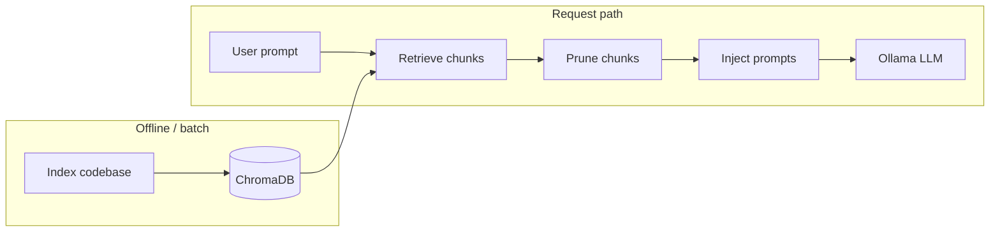

# Context Engineering — Thesis Project

This repository contains research and implementation work for a **Context Engineering** system: managing, retrieving, pruning, and injecting context for LLM-assisted coding, with a **local Ollama** agent and **ChromaDB** + **sentence-transformers** for code indexing and retrieval.

Related materials in the repo:

- `Context Engineering Literature Survey.pdf` — survey of context engineering, RAG, and related ideas.
- `Thesis Proposal Presentation 1.pdf` — proposal slides.

---

## Table of contents

1. [High-level architecture](#high-level-architecture)
2. [Repository layout](#repository-layout)
3. [Pipeline and tool registry](#pipeline-and-tool-registry)
4. [Major components](#major-components)
5. [Python environment](#python-environment)
6. [Installation](#installation)
7. [Running the MCP server](#running-the-mcp-server)
8. [HTTP API](#http-api)
9. [Smoke tests](#smoke-tests)
10. [Manual test cases (`TESTCASES.md`)](#manual-test-cases-testcasesmd)
11. [Manual and integration scripts](#manual-and-integration-scripts)
12. [Ollama](#ollama)
13. [Paths, data, and ignores](#paths-data-and-ignores)
14. [Import paths and `PYTHONPATH](#import-paths-and-pythonpath)`
15. [Branches and integration](#branches-and-integration)
16. [Known limitations](#known-limitations)
17. [Troubleshooting](#troubleshooting)

---

## High-level architecture




- **Indexing** embeds code chunks and stores them in **ChromaDB** (cosine space, collection `code_embeddings` by default).
- **Retrieval** queries Chroma with the user prompt (hybrid / ranking logic in `retrieval_tool.py`).
- **Pruning** is implemented (structure-aware pruning + token-budget selection) and wired into the pipeline.
- **Injection** builds structured **system** + **user** messages from chunks (`PromptBuilder` / `build_coding_prompt`).
- **Agent** calls **Ollama** over HTTP (`/api/chat` when both system and user are set).

Default embedding model: `**all-MiniLM-L6-v2`** (shared via `backend/indexing/sentence_model.py` so the indexer and retrieval do not load two separate copies).

---

## Repository layout

```
Context-Engineering-Thesis1/
├── README.md                          # This file
├── TESTCASES.md                       # Manual test cases: TC-01–TC-20, commands, execution record
├── requirements.txt                   # Minimal deps (e.g. typing_extensions on Python 3.7)
├── Context Engineering Literature Survey.pdf
├── Thesis Proposal Presentation 1.pdf
├── .gitignore                         # Root ignores (flask_test, chroma_db, pycache, .deps, …)
└── backend/
    ├── .gitignore                     # Backend-specific ignores (chroma_db, test_chroma_db, …)
    ├── smoke_test.py                  # Tier A / B integration smoke tests
    ├── chroma_db/                     # Default Chroma persistence (local, gitignored)
    ├── mcp_server/
    │   ├── server.py                  # FastAPI app, /generate, /index
    │   ├── tool_registry.py           # Registers tools; orchestration seam
    │   └── run_demo.py                # Simple CLI client for POST /generate
    ├── indexing/
    │   ├── code_indexer.py            # Chunking, embeddings, Chroma upsert/query
    │   ├── code_indexer_endpoint.py   # Thin adapter: index_codebase
    │   ├── sentence_model.py          # Shared SentenceTransformer singleton
    │   ├── requirements.txt           # chromadb, sentence-transformers, fastapi, etc.
    │   ├── test_code_indexer.py       # Large indexer test script
    │   └── query_test.py              # Query experiments
    ├── retrieval/
    │   ├── retrieval_tool.py          # Vector + hybrid retrieval from Chroma
    │   └── retrieval_tool_endpoint.py # Thin adapter: retrieve_context
    ├── pruning/
    │   ├── file.py                    # Structure-aware pruner (P4)
    │   ├── __init__.py                # Exports prune_context + helpers
    │   └── pruning_tool_endpoint.py   # Thin adapter: prune_context (tool_registry integration)
    ├── injection/
    │   ├── prompt_builder.py          # PromptBuilder, ContextChunk, token budget, line numbers
    │   ├── prompt_builder_endpoint.py # inject_context → {system, user}
    │   └── chunk_normalize.py       # Strip duplicate editor line-number columns
    ├── agent/
    │   ├── ollama_agent.py            # Ollama HTTP client (chat + generate)
    │   └── agent_endpoint.py          # ollama_generate tool
    ├── agent_integ_test.py            # Manual pipeline script (retrieve → prune → inject → generate)
    ├── injection_integ_test.py
    ├── retrieval_integ_test.py
    └── indexing_integ_test.py
```

There is **no** top-level `src/` package in this branch snapshot; the active code lives under `**backend/`**.

---

## Pipeline and tool registry

`backend/mcp_server/tool_registry.py` registers tools by name. `call_tool(name, *args, **kwargs)` dispatches to the registered function. Missing tools raise `**ValueError**`.


| Registered name    | Role                                                           |
| ------------------ | -------------------------------------------------------------- |
| `index_codebase`   | Index a repository into Chroma (see `code_indexer_endpoint`)   |
| `retrieve_context` | Retrieve ranked chunks for a query                             |
| `prune_context`    | Structure-aware pruning (P4) → PromptBuilder-compatible chunks |
| `inject_context`   | Build `{"system": str, "user": str}` for the LLM               |
| `ollama_generate`  | Call Ollama (uses **chat** when `system` + `user` are present) |


**Note:** Importing `tool_registry` pulls in `code_indexer_endpoint`, which constructs a global `**CodeIndexer`** at import time. That loads the embedding model and opens Chroma—expect a **cold start** cost.

---

## Major components

### P2 — Indexing (`backend/indexing/`)

- Scans a repo, chunks code (Python AST + heuristics for other languages), embeds with **SentenceTransformer**, stores in **ChromaDB**.
- `**sentence_model.get_sentence_transformer()`** ensures one shared model instance for indexing and retrieval.

### P3 — Retrieval (`backend/retrieval/`)

- `**vector_retrieve**`, `**hybrid_retrieve**`, ranking and stitching helpers.
- Uses the **same** embedding model as indexing via `sentence_model`.

### P4 — Pruning

- Implemented in `backend/pruning/file.py` and exposed as a tool via `backend/pruning/pruning_tool_endpoint.py`.
- Pipeline call signature: `prune_context(query, retrieved_items, token_budget=...)` → returns PromptBuilder-compatible chunks.
- Unit tests live in `tests/backend/test_pruning.py`.

### P5 — Injection + agent (`backend/injection/`, `backend/agent/`)

- `**PromptBuilder`** / `**build_coding_prompt**`: structured `ContextChunk` (paths, symbols, optional line numbers, token budget / truncation notice).
- `**chunk_normalize**` optionally strips a uniform `NN |` editor prefix so line numbers are not doubled when `PromptBuilder` adds its own column.
- `**inject_context**` returns `**dict` with keys `system` and `user**` (not a single XML blob).
- `**OllamaAgent**`: `generate_response(prompt, system=None)` — uses `**/api/chat**` when `system` is set, else `**/api/generate**`.

### MCP server (`backend/mcp_server/server.py`)

- `**run_pipeline**` (used by `POST /generate`): `retrieve_context` → `prune_context` → `inject_context` → `ollama_generate`.

---

## Python environment


| Use case                                                          | Python version                                    | Notes                                                                                   |
| ----------------------------------------------------------------- | ------------------------------------------------- | --------------------------------------------------------------------------------------- |
| `PromptBuilder` only (Tier A smoke)                               | **3.8+** native, or **3.7** + `typing_extensions` | Root `requirements.txt` pins `typing_extensions` for 3.7                                |
| Full stack (Chroma, sentence-transformers, FastAPI, smoke Tier B) | **3.10+** strongly recommended                    | Use **conda** or a healthy install; avoid **broken pyenv 3.7** (e.g. missing `_ctypes`) |


**Important:** Always install packages with the **same interpreter** you run:

```bash
/path/to/python3.12 -m pip install ...   # correct
pip install ...                         # may target wrong Python (e.g. pyenv 3.7)
```

---

## Installation

From the **repository root**:

1. **Minimal (Tier A / typing only on 3.7)**
  ```bash
   pip install -r requirements.txt
  ```
2. **Full backend (indexing + server + smoke Tier B)**
  Use Python **3.10+** (e.g. conda):
   Optionally add `httpx` (FastAPI TestClient) if not already pulled in.
3. **Ollama** — install separately on the host; see [Ollama](#ollama).

---

## Running the MCP server

The FastAPI app expects imports that resolve `**mcp_server`** and `**tool_registry**` next to each other. The usual pattern:

```bash
cd /path/to/Context-Engineering-Thesis1/backend/mcp_server
PYTHONPATH=.. uvicorn server:app --reload --host 127.0.0.1 --port 8000
```

- `**PYTHONPATH=..**` adds `**backend/**` so packages `indexing`, `retrieval`, `injection`, `agent`, `mcp_server` import correctly.

Because `**backend/**` is not necessarily an installable package (no `pyproject.toml` here), prefer the `**cd backend/mcp_server` + `PYTHONPATH=..**` pattern above unless you add packaging.

---

## HTTP API

Base URL example: `http://127.0.0.1:8000`


| Method | Path        | Description                                                                                                                                                             |
| ------ | ----------- | ----------------------------------------------------------------------------------------------------------------------------------------------------------------------- |
| `GET`  | `/`         | Health: JSON includes `"Context Engine Running"` and **`"ui": "/ui"`** for the browser prompt page.                                                                      |
| `GET`  | `/ui`       | **Simple web UI** — prompt box, **Run pipeline** (`POST /generate`), **Index** (`POST /index`). Same origin as the API (open after starting uvicorn).                    |
| `POST` | `/generate` | **JSON body** `{"prompt": "<user text>"}` → `{"output": "<model response>"}`                                                                                            |
| `POST` | `/index`    | **Query parameters** `repo_path` (optional), `languages` (optional), `include_dirs` (optional), `max_files` (default `600`), `rebuild_bm25` (default `false`). If `repo_path` is omitted, defaults to `**backend/flask_test`** under the server’s backend layout. |


**Inconsistency:** `/generate` uses **JSON body**; `/index` uses **query string**. Documented here so API clients are not surprised.

---

## Fast Superset Indexing

For the Superset thesis demo, indexing the whole checkout can be slow because it includes docs, tests, frontend assets, and generated-looking support files. Prefer source-first indexing:

```bash
curl -sS -X POST \
  "http://127.0.0.1:8000/index?repo_path=/home/g7/Documents/ThesisProject/apache-superset&languages=python&include_dirs=superset&include_dirs=superset-core/src&max_files=800"
```

Repeat the same command until `files_indexed` becomes `0`. The indexer is incremental, so repeated runs skip files already processed for the current contextual-index schema.

Useful speed knobs:

- `INDEX_CPU_THREADS=4` controls PyTorch CPU thread usage.
- `INDEX_EMBED_BATCH_SIZE=32` controls embedding batch size.
- `max_files=800` limits work per run so the machine stays responsive.
- Leave `rebuild_bm25=false` for normal runs; BM25 is updated only for touched chunks.
- Use `rebuild_bm25=true` only when you intentionally want a slower full lexical rebuild.

---

## Retrieval Upgrade Resources

The retrieval upgrade follows these references:

- [Anthropic: Contextual Retrieval](https://www.anthropic.com/news/contextual-retrieval) for contextual chunk/file headers before embedding and BM25 indexing.
- [rank-bm25 on PyPI](https://pypi.org/project/rank-bm25/) and [rank-bm25 source](https://github.com/dorianbrown/rank_bm25) for the BM25 lexical retrieval stream.
- [Okapi BM25 overview](https://en.wikipedia.org/wiki/Okapi_BM25) for the ranking function background.
- [Sentence-Transformers CrossEncoder docs](https://www.sbert.net/examples/applications/cross-encoder/README.html) for optional reranking.
- [cross-encoder/ms-marco-MiniLM-L-6-v2](https://huggingface.co/cross-encoder/ms-marco-MiniLM-L-6-v2) as the compact optional reranker model.
- [Chroma docs](https://docs.trychroma.com/) for the persistent vector store and metadata search.

---

## Smoke tests

### Location

`backend/smoke_test.py`

### How to run

From repo root:

```bash
/opt/anaconda3/bin/python3.12 backend/smoke_test.py
```

(use your actual Python 3.10+ path)

### Tiers


| Tier  | Needs                                                                                   | What it checks                                                                                                                            |
| ----- | --------------------------------------------------------------------------------------- | ----------------------------------------------------------------------------------------------------------------------------------------- |
| **A** | `typing_extensions` on 3.7 only                                                         | `PromptBuilder` + line numbers; `chunk_normalize` behavior                                                                                |
| **B** | `chromadb`, sentence-transformers, fastapi, uvicorn, pydantic; Ollama for a real answer | Imports FastAPI app, `GET /`, `POST /generate` with JSON; full `run_pipeline` (may 500 if Ollama/index missing; success path returns 200) |


If Tier B is skipped, install deps with `**python3.12 -m pip install ...`** as above.

---

## Manual test cases (`TESTCASES.md`)

End-to-end checks against the **running** server (`curl` to `/`, `/generate`, `/index`) plus the **smoke script** are documented in **[`TESTCASES.md`](TESTCASES.md)** at the repository root. That file holds:

- **TC-01–TC-11** — baseline API and RAG checks  
- **TC-12–TC-20** — **hard** Subversion-focused pipeline tests (multi-step FS lifecycle, error pathology, semantic-only queries, multi-symbol tables, delta editor, **TC-20** verbatim ground-truth quote / hallucination probe, etc.) plus **§2.1** on how to design cases from an indexed tree  
- **Execution record** — summary table and per-TC evidence log (update when you re-test)  
- **Verdict rubric** — Pass / Partial / Fail

Use it as the single place to record thesis or regression manual test evidence alongside `backend/smoke_test.py`.

---

## Manual and integration scripts

Run from `**backend/**` with `**PYTHONPATH=.**` (or equivalent) so `mcp_server` and sibling packages resolve:


| Script                    | Purpose                                                                             |
| ------------------------- | ----------------------------------------------------------------------------------- |
| `mcp_server/run_demo.py`  | Prompts for text; `POST http://localhost:8000/generate` with `json={"prompt": ...}` |
| `agent_integ_test.py`     | Retrieve → prune → inject → `ollama_generate`                                       |
| `injection_integ_test.py` | Retrieve → inject (prints prompt sizes)                                             |
| `retrieval_integ_test.py` | Retrieval-focused                                                                   |
| `indexing_integ_test.py`  | Calls `index_codebase` with a sample path                                           |

### Pruning tests (P4)

Run pruning unit tests with Python 3.10+:

```bash
python3.12 -m pytest -q tests/backend/test_pruning.py
```


---

## Ollama

- Default agent model in code is often `**qwen3.5:9b**` (see `OllamaAgent`); override with your model name if different.
- Ollama must be **running** on the host (default `**http://localhost:11434`**).
- Example pull:
  ```bash
  ollama pull llama3.2:3b
  ```
- Large timeouts may be needed for slow models; `OllamaAgent` supports a configurable `timeout`.

---

## Paths, data, and ignores


| Path / pattern            | Role                                                                        |
| ------------------------- | --------------------------------------------------------------------------- |
| `backend/chroma_db/`      | Default Chroma persistence (ignored in git via `.gitignore`)                |
| `flask_test/`             | Default sample repo for indexing when `repo_path` not passed (root ignored) |
| `backend/test_chroma_db/` | Mentioned in backend ignore for indexer tests                               |
| `.deps/`                  | Optional local dependency installs (ignored)                                |


Do **not** commit `chroma_db` contents unless your team explicitly wants a frozen DB in the repo.

---

## Import paths and `PYTHONPATH`

- Packages are named `**indexing`**, `**retrieval**`, `**injection**`, `**agent**`, `**mcp_server**` relative to `**backend/**` (flat imports: `from injection...`, not `from backend.injection...`, when `backend` is on the path).
- `**backend/**` must be on `**PYTHONPATH**`, or use `cd backend` and `export PYTHONPATH=.` for scripts run from that directory.
- If you see `ModuleNotFoundError` for `indexing` / `mcp_server`, the process does not see `**backend/**` on `PYTHONPATH`.
  ```bash
  export PYTHONPATH=/path/to/Context-Engineering-Thesis1/backend
  ```

---

## Branches and integration

- Integration work may live on branches such as `**final-integration**` or `**Code-Indexing-&-Embeddings**`.
- **Pushing a new branch** (e.g. `final-integration`) does **not** automatically update another branch; merge via **Pull Request** or merge locally when ready.
- Rebasing or merging **with `main`** may require **conflict resolution** if histories diverged.

---

## Known limitations


| Limitation             | Detail                                                                                 |
| ---------------------- | -------------------------------------------------------------------------------------- |
| **Pruning**            | Implemented, but still a heuristic pruner; strategy/thresholds may evolve              |
| **Auth**               | API has no authentication or rate limiting (local / research use)                      |
| **Heavy import**       | Loading `tool_registry` initializes indexer + model + Chroma                           |
| **Two Chroma clients** | Indexer and retrieval each open a client to the same path (acceptable, minor overhead) |


---

## Troubleshooting


| Symptom                                                    | Likely cause                  | What to try                                                                                    |
| ---------------------------------------------------------- | ----------------------------- | ---------------------------------------------------------------------------------------------- |
| `ModuleNotFoundError: No module named 'typing_extensions'` | Python 3.7 without package    | `pip install 'typing_extensions>=4'` or use 3.10+                                              |
| `No module named '_ctypes'` during `pip install`           | Broken / minimal Python build | Use conda or reinstall Python                                                                  |
| `pip` installs to wrong Python                             | pyenv vs conda shims          | `which python` / `python -m pip install ...`                                                   |
| Tier B skipped                                             | `chromadb` not importable     | Install with same interpreter as smoke test                                                    |
| `POST /generate` 422                                       | Wrong body shape              | Send JSON `{"prompt": "..."}`                                                                  |
| Empty retrieval                                            | Chroma has 0 docs             | Run `POST /index` with a real `repo_path` or use default `flask_test` after placing code there |
| Import errors for `mcp_server` or `indexing`               | Wrong cwd / `PYTHONPATH`      | `cd backend/mcp_server` and `PYTHONPATH=..` for uvicorn                                        |


---

## Quick reference

Manual test cases (**TC-01–TC-20**, including advanced Subversion pipeline stress tests and **TC-20** ground-truth quote check) and execution record: **`TESTCASES.md`** (repo root).

```bash
# Smoke test (full stack)
/opt/anaconda3/bin/python3.12 backend/smoke_test.py

# Server (typical)
cd backend/mcp_server && PYTHONPATH=.. uvicorn server:app --reload --host 127.0.0.1 --port 8000

# Generate (with server up)
curl -s -X POST http://127.0.0.1:8000/generate \
  -H "Content-Type: application/json" \
  -d '{"prompt":"Your question about the codebase"}'

# Browser UI (with server up)
open http://127.0.0.1:8000/ui   # macOS; or visit /ui in any browser
```

---

*This README reflects the backend integration as described in the thesis workflow; we need to update sections when pruning, packaging, or deployment change.*
