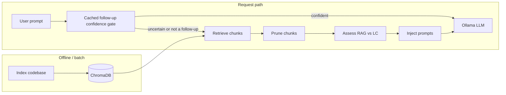

# Context Engineering — Thesis Project

This repository contains research and implementation work for a **Context Engineering** system: managing, retrieving, pruning, and injecting context for LLM-assisted coding, with a **local Ollama** agent and **ChromaDB** + **sentence-transformers** for code indexing and retrieval.

Related materials in the repo:

- `Context Engineering Literature Survey.pdf` — survey of context engineering, RAG, and related ideas.
- `Thesis Proposal Presentation 1.pdf` — proposal slides.

---

## Table of contents

1. [High-level architecture](#high-level-architecture)
2. [Repository layout](#repository-layout)
3. [Pipeline and tool registry](#pipeline-and-tool-registry)
4. [Major components](#major-components)
5. [Python environment](#python-environment)
6. [Installation](#installation)
7. [Running the MCP server](#running-the-mcp-server)
8. [HTTP API](#http-api)
9. [Web UI (`/ui`)](#web-ui-ui)
10. [Smoke tests](#smoke-tests)
11. [Manual test cases (`TESTCASES.md`)](#manual-test-cases-testcasesmd)
12. [Manual and integration scripts](#manual-and-integration-scripts)
13. [Ollama](#ollama)
14. [Paths, data, and ignores](#paths-data-and-ignores)
15. [Import paths and `PYTHONPATH`](#import-paths-and-pythonpath)
16. [Retrieval modes (vector vs graph)](#retrieval-modes-vector-vs-graph)
17. [Branches and integration](#branches-and-integration)
18. [Known limitations](#known-limitations)
19. [Troubleshooting](#troubleshooting)

---

## High-level architecture



- In `SELF_ROUTE`, a regex prefilter first identifies assistant-referential follow-ups. Only those questions receive a short draft prompt containing the previous assistant reply and cached code context. Ollama token logprob margins are used when supported; otherwise three drafts are compared for consistency. A statistically confident draft must also pass a separate cached-source support check before it can skip retrieval; an uncertain or unsupported draft continues through retrieval, pruning, and the RAG-vs-LC assessor. Meta-memory and normal coding questions bypass the confidence model call.
- **Indexing** embeds code chunks and stores them in **ChromaDB** (cosine space, collection `code_embeddings` by default).
- **Retrieval** uses **hybrid** signals (dense vectors, BM25-style keywording, path/symbol hooks, then ranking) implemented in `backend/retrieval/retrieval_tool.py`. It is not “pure dense vector only,” but the dominant signal is still embedding similarity over the same index.
- **Pruning** is structure-aware and token-budget–driven (`backend/pruning/file.py`), wired into `run_pipeline` and the tools.
- **Injection** builds structured **system** + **user** messages from chunks (`PromptBuilder` / `build_coding_prompt`).
- **Agent** calls **Ollama** over HTTP (`/api/chat` when both system and user are set).

Default embedding model: **`all-MiniLM-L6-v2`** (shared via `backend/indexing/sentence_model.py` so the indexer and retrieval reuse one model load).

---

## Repository layout

```
Context-Engineering-Thesis1/
├── README.md                          # This file
├── TESTCASES.md                       # Manual test cases, commands, execution record
├── results/                           # `evaluate` metric tables (`*/results.md`) + auto JSON dumps (`*/json/*.json`) when `POST /evaluate` sets `save_metrics_json`
├── requirements.txt                   # Minimal deps (e.g. typing_extensions on Python 3.7)
├── Context Engineering Literature Survey.pdf
├── Thesis Proposal Presentation 1.pdf
├── .gitignore                         # Root ignores (flask_test, chroma_db, pycache, .deps, …)
└── backend/
    ├── .gitignore                     # Backend-specific ignores (chroma_db, test_chroma_db, …)
    ├── smoke_test.py                  # Tier A / B integration smoke tests
    ├── chroma_db/                     # Default Chroma persistence (local, gitignored)
    ├── mcp_server/
    │   ├── server.py                  # FastAPI app: /generate, /index, /index/summary, /ui
    │   ├── tool_registry.py           # Registers tools; orchestration seam
    │   ├── run_demo.py                # Simple CLI client for POST /generate
    │   └── static/
    │       └── index.html             # Pipeline dashboard (same origin as API)
    ├── indexing/
    │   ├── code_indexer.py            # Chunking, embeddings, Chroma upsert/query
    │   ├── code_indexer_endpoint.py   # index_codebase, get_index_summary
    │   ├── sentence_model.py          # Shared SentenceTransformer singleton
    │   ├── requirements.txt           # chromadb, sentence-transformers, FastAPI, …
    │   ├── test_code_indexer.py       # Large indexer test script
    │   └── query_test.py              # Query experiments
    ├── retrieval/
    │   ├── retrieval_tool.py          # Hybrid retrieval, ranking, file-context stitching
    │   └── retrieval_tool_endpoint.py # retrieve_context
    ├── pruning/
    │   ├── file.py                    # Structure-aware pruner (P4); prune_context_with_stats
    │   ├── __init__.py                # Exports prune_context + helpers
    │   └── pruning_tool_endpoint.py   # prune_context (tool_registry)
    ├── injection/
    │   ├── prompt_builder.py          # PromptBuilder, ContextChunk, token budget, line numbers
    │   ├── prompt_builder_endpoint.py # inject_context → {system, user}
    │   └── chunk_normalize.py         # Strip duplicate editor line-number columns
    ├── agent/
    │   ├── ollama_agent.py            # Ollama HTTP client (chat + generate)
    │   └── agent_endpoint.py          # ollama_generate tool
    ├── agent_integ_test.py            # Manual pipeline script (retrieve → prune → inject → generate)
    ├── injection_integ_test.py
    ├── retrieval_integ_test.py
    ├── indexing_integ_test.py
    └── tests/                         # Pytest (see tests/backend/test_pruning.py)
```

There is **no** top-level `src/` package in this layout; runnable code lives under **`backend/`**.

---

## Pipeline and tool registry

`backend/mcp_server/tool_registry.py` registers tools by name. `call_tool(name, *args, **kwargs)` dispatches to the registered function. Missing tools raise **`ValueError`**.

| Registered name      | Role                                                                                                                       |
| -------------------- | -------------------------------------------------------------------------------------------------------------------------- |
| `index_codebase`     | Index a repository into Chroma + write `call_graph.json` sidecar (see `code_indexer_endpoint`)                              |
| `retrieve_context`   | Retrieve ranked chunks for a query. Accepts `mode={"vector","graph"}` — see [Retrieval modes](#retrieval-modes-vector-vs-graph) |
| `prune_context`      | Structure-aware pruning (P4) → PromptBuilder-compatible chunks                                                              |
| `inject_context`     | Build `{"system": str, "user": str}` for the LLM                                                                            |
| `ollama_generate`    | Call Ollama (**chat** when `system` + `user` are present)                                                                   |

**Note:** Importing `tool_registry` pulls in `code_indexer_endpoint`, which constructs a global **`CodeIndexer`** at import time. That loads the embedding model and opens Chroma—expect a **cold start** cost.

---

## Major components

### P2 — Indexing (`backend/indexing/`)

- Scans a repo, chunks code (Python AST + heuristics for other languages), embeds with **SentenceTransformer**, stores in **ChromaDB**.
- **`sentence_model.get_sentence_transformer()`** ensures one shared model instance for indexing and retrieval.

### P3 — Retrieval (`backend/retrieval/`)

- **`vector_retrieve`**, **`hybrid_retrieve`**, **`retrieve_context`** (ranking + optional parent file context reconstruction).
- Uses the **same** embedding model as indexing via `sentence_model`.

### P4 — Pruning

- Implemented in `backend/pruning/file.py` and exposed as `prune_context` via `pruning_tool_endpoint.py`.
- **`prune_context_with_stats`** (used by the HTTP pipeline) adds pruning statistics for dashboards.
- Tool signature conceptually: `(query, retrieved_items, token_budget=...)` → PromptBuilder-compatible chunks.
- Unit tests: `tests/backend/test_pruning.py`.

### P5 — Injection + agent (`backend/injection/`, `backend/agent/`)

- **`PromptBuilder`** / **`build_coding_prompt`**: structured `ContextChunk` (paths, symbols, optional line numbers, token budget / truncation notice).
- **`chunk_normalize`** optionally strips a uniform `NN |` editor prefix so line numbers are not doubled when `PromptBuilder` adds its own column.
- **`inject_context`** returns a **`dict`** with keys **`system`** and **`user`** (not a single XML blob).
- **`OllamaAgent`**: `generate_response(prompt, system=None)` — uses **`/api/chat`** when `system` is set, else **`/api/generate`**.

### MCP server (`backend/mcp_server/server.py`)

- **`run_pipeline`** (used by `POST /generate`): `retrieve_context` → `prune_context_with_stats` → `inject_context` → `ollama_generate`, with default **`token_budget=1800`** for pruning.

---

## Python environment

| Use case                                                          | Python version                                    | Notes                                                                                   |
| ----------------------------------------------------------------- | ------------------------------------------------- | --------------------------------------------------------------------------------------- |
| `PromptBuilder` only (Tier A smoke)                               | **3.8+** native, or **3.7** + `typing_extensions` | Root `requirements.txt` pins `typing_extensions` for 3.7                                |
| Full stack (Chroma, sentence-transformers, FastAPI, smoke Tier B) | **3.10+** strongly recommended                    | Use **conda** or a healthy install; avoid **broken pyenv 3.7** (e.g. missing `_ctypes`) |

**Important:** Always install packages with the **same interpreter** you run:

```bash
/path/to/python3.12 -m pip install ...   # correct
pip install ...                          # may target wrong Python (e.g. pyenv 3.7)
```

---

## Installation

From the **repository root**:

1. **Minimal (Tier A / typing only on 3.7)**

   ```bash
   pip install -r requirements.txt
   ```

2. **Full backend (indexing + server + smoke Tier B)**  
   Use Python **3.10+**. Install backend dependencies (and add **uvicorn** for the server if not already present):

   ```bash
   python3.12 -m pip install -r backend/indexing/requirements.txt uvicorn
   ```

   Optionally add **`httpx`** if you use tooling that expects it alongside FastAPI’s test client elsewhere.

3. **Ollama** — install separately on the host; see [Ollama](#ollama).

---

## Running the MCP server

The FastAPI app expects imports that resolve **`mcp_server`** and **`tool_registry`** relative to **`backend/`**. Typical invocation:

```bash
cd /path/to/Context-Engineering-Thesis1/backend/mcp_server
PYTHONPATH=.. uvicorn server:app --reload --host 127.0.0.1 --port 8000
```

- **`PYTHONPATH=..`** adds **`backend/`** so packages `indexing`, `retrieval`, `injection`, `agent`, `mcp_server` import correctly.

Because **`backend/`** is not necessarily an installable package (no `pyproject.toml` at repo root), prefer **`cd backend/mcp_server`** + **`PYTHONPATH=..`** unless you add packaging.

---

## HTTP API

Base URL example: `http://127.0.0.1:8000`

| Method | Path              | Description |
| ------ | ----------------- | ----------- |
| `GET`  | `/`               | Health: JSON `message` (e.g. **Context Engine Running**) and **`ui`: `/ui`**. |
| `GET`  | `/ui`             | Serves **`static/index.html`** — pipeline dashboard (see [Web UI](#web-ui-ui)). |
| `GET`  | `/index/summary`  | Indexed file/chunk summary for the dashboard. Query: **`file_limit`** (default `500`, max `5000`). |
| `POST` | `/generate`       | **JSON body** `{"prompt": "<user text>", "retrieval_mode": "vector"\|"graph"}`. Success body includes **`output`** and **`pipeline`** (per-stage summaries, timing, optional raw traces, plus `retrieval_mode`). |
| `POST` | `/evaluate`       | **JSON body** with `prompt`, `top_k`, `token_budget`, `retrieval_mode` (`"vector"` or `"graph"`), optional `relevant_files`, `judge_retrieval_relevancy`, `faithfulness`, `save_metrics_json`. Persists JSON to `results/<retrieval_mode>/json/` when enabled. |
| `POST` | `/index`          | **Query parameters** `repo_path` (optional), `languages` (optional list). If `repo_path` is omitted, defaults to **`backend/flask_test`**. Response includes indexer fields plus **`index_summary`** and a `graph_path` for the `call_graph.json` sidecar. |

**Inconsistency by design:** `/generate` uses a **JSON body**; `/index` uses **query string** parameters. Callers should not mix these styles by mistake.

---

## Web UI (`/ui`)

The dashboard (`backend/mcp_server/static/index.html`) provides:

- **Run pipeline** — `POST /generate` with the prompt in the page.
- **Index** — default repo or a custom absolute path (advanced section).
- **Refresh index summary** — `GET /index/summary` with file/chunk metrics and an optional raw JSON view.
- **Pipeline Manager** — visual stages (index context, retrieve, prune, inject, generate) updated after a run.
- **Stage evidence** — presentation-safe previews; **Model output** and collapsible **raw pipeline JSON**.

If you open `index.html` as a **`file://`** URL, the UI shows a warning: use **`http://127.0.0.1:8000/ui`** so `fetch` can reach the API.

---

## Smoke tests

### Location

`backend/smoke_test.py`

### How to run

From repo root:

```bash
/path/to/python3.12 backend/smoke_test.py
```

(or `python backend/smoke_test.py` with a 3.10+ interpreter)

### Tiers

| Tier  | Needs                                                                                   | What it checks                                                                                                                                 |
| ----- | --------------------------------------------------------------------------------------- | ----------------------------------------------------------------------------------------------------------------------------------------------- |
| **A** | `typing_extensions` on 3.7 only                                                         | `PromptBuilder` + line numbers; `chunk_normalize` behavior                                                                                    |
| **B** | `chromadb`, sentence-transformers, fastapi, uvicorn, pydantic; Ollama for a full answer | Imports FastAPI app, `GET /`, `POST /generate` with JSON; **HTTP 200 or 500** accepted (500 if retrieval/Ollama/index missing proves routing) |

Tier B asserts **`output`** exists on **`200`** responses; it does not require **`pipeline`** in the assertion (that field is still returned when the pipeline completes successfully).

---

## Manual test cases (`TESTCASES.md`)

End-to-end checks against the **running** server (`curl` to `/`, `/generate`, `/index`) plus **`backend/smoke_test.py`** are documented in **[`TESTCASES.md`](TESTCASES.md)** at the repository root. That file holds:

- **TC-01–TC-09** — **Apache Superset–oriented** RAG prompts, edge inputs, indexing, smoke script
- **TC-10–TC-18** — deeper Superset pipeline and source-first retrieval checks; **§4.1** natural user prompts
- **Execution record** — summary table and per-TC evidence (update when you re-test)
- **Verdict rubric** — Pass / Partial / Fail

Use it as the single place to record thesis or regression manual evidence alongside `backend/smoke_test.py`.

---

## Manual and integration scripts

Run from **`backend/`** with **`PYTHONPATH=.`** (or equivalent) so `mcp_server` and sibling packages resolve:

| Script                    | Purpose                                                                             |
| ------------------------- | ----------------------------------------------------------------------------------- |
| `mcp_server/run_demo.py`  | Prompts for text; `POST http://localhost:8000/generate` with `json={"prompt": ...}` |
| `agent_integ_test.py`     | Retrieve → prune → inject → `ollama_generate`                                       |
| `injection_integ_test.py` | Retrieve → inject (prints prompt sizes)                                             |
| `retrieval_integ_test.py` | Retrieval-focused                                                                   |
| `indexing_integ_test.py`  | Calls `index_codebase` with a sample path                                           |

### Pruning tests (P4)

```bash
python3.12 -m pytest -q tests/backend/test_pruning.py
```

---

## Ollama

- Default agent model in **`agent_endpoint.py`** is **`qwen3.5:9b`** (must exist in `ollama list` or change the tag).
- Ollama listens at **`http://localhost:11434`** by default (`OllamaAgent` **`base_url`**).
- **`OllamaAgent`** also reads:
  - **`OLLAMA_NUM_PREDICT`** — max tokens to generate (default **`8192`**).
  - **`OLLAMA_THINK`** — when truthy, enables thinking traces for APIs that support the `think` flag (often slower).
- Example pull:

  ```bash
  ollama pull llama3.2:3b
  ```

- Default HTTP **`timeout`** is **600** seconds for slow local models; adjust in code if needed.

---

## Paths, data, and ignores

| Path / pattern            | Role                                                                        |
| ------------------------- | --------------------------------------------------------------------------- |
| `backend/chroma_db/`      | Default Chroma persistence (ignored in git via `.gitignore`)                |
| `flask_test/`             | Default sample repo for indexing when `repo_path` not passed (root ignored)   |
| `backend/test_chroma_db/` | Mentioned in backend ignore for indexer tests                               |
| `.deps/`                  | Optional local dependency installs (ignored)                                  |

Do **not** commit `chroma_db` contents unless your team explicitly wants a frozen DB in the repo.

---

## Import paths and `PYTHONPATH`

- Packages are named **`indexing`**, **`retrieval`**, **`injection`**, **`agent`**, **`mcp_server`** relative to **`backend/`** (flat imports: `from injection...`, not `from backend.injection...`, when `backend` is on the path).
- **`backend/`** must be on **`PYTHONPATH`**, or use `cd backend` and `export PYTHONPATH=.` for scripts run from that directory.
- If you see `ModuleNotFoundError` for `indexing` / `mcp_server`, the process does not see **`backend/`** on `PYTHONPATH`:

  ```bash
  export PYTHONPATH=/path/to/Context-Engineering-Thesis1/backend
  ```

---

## Retrieval modes (vector vs graph)

The pipeline ships with two switchable retrieval backends so they can be A/B compared on the same prompts:

| Mode    | What it does                                                                                                                  |
| ------- | ----------------------------------------------------------------------------------------------------------------------------- |
| `vector` (default) | Hybrid dense + BM25 + exact-symbol search, cross-encoder rerank, late-chunking file context reconstruction. No graph signal. |
| `graph` | Same candidate set as `vector`, then a final **structural rerank** that blends `final_score` with PageRank / in-degree from `call_graph.json`. Falls back to `vector` if the sidecar is missing. |

### Artifacts produced by indexing

Indexing (`POST /index` or `CodeIndexer.index_repository`) writes three things under `backend/chroma_db/`:

- `code_embeddings` (Chroma collection) — pure semantic vectors. Unchanged by mode.
- `bm25_index.json` — lexical index used by the hybrid stage.
- `call_graph.json` — **new** sidecar produced by `backend/indexing/graph_builder.py` (multi-language call graph: Python AST + regex for JS/TS/Java/Go/C/C++). Consumed by `graph` mode.

The same index serves both modes, so you only re-index once after pulling this branch on a new machine.

### Switching modes

- **Web UI** — both the **Dashboard** tab (next to *Run pipeline*) and the **Evaluation** tab have a *Retrieval mode* dropdown. The active mode shows up in the pipeline output card and in the quick-metrics line.
- **HTTP** — `POST /generate` and `POST /evaluate` accept `"retrieval_mode": "vector" | "graph"` in the JSON body (default `"vector"`).
- **CLI** — `python -m context_metrics.run_pipeline_metrics --retrieval-mode {vector,graph} ...`. Add `--save-json` to persist the payload to `results/<mode>/json/`, mirroring the `/evaluate` endpoint.

### Tuning the graph rerank

The graph rerank has three knobs, all adjustable per-run from UI / API / CLI without restarting the server:

| Knob          | Range / meaning                                                                                       | UI / API field        | CLI flag                  | Env-var default              |
| ------------- | ----------------------------------------------------------------------------------------------------- | --------------------- | ------------------------- | ---------------------------- |
| `alpha`       | `0..1`. Weight on the hybrid score; `(1 - alpha)` goes to the structural score.                       | `graph_alpha`         | `--graph-alpha`           | `GRAPH_RERANK_ALPHA=0.65`    |
| `w_pagerank`  | `≥ 0`. PageRank weight inside the structural score. Auto-normalized with `w_indegree` so they sum to 1.| `graph_w_pagerank`    | `--graph-w-pagerank`      | `GRAPH_RERANK_W_PAGERANK=0.65` |
| `w_indegree`  | `≥ 0`. Normalized in-degree weight inside the structural score. Same auto-normalization.              | `graph_w_indegree`    | `--graph-w-indegree`      | `GRAPH_RERANK_W_INDEGREE=0.35` |

- **UI** — both the Dashboard and Evaluation tabs have a collapsed *Graph rerank weights* panel that expands automatically when you pick graph mode. Empty fields keep the env defaults.
- **HTTP** — pass any subset of `graph_alpha`, `graph_w_pagerank`, `graph_w_indegree` in the JSON body for `/generate` or `/evaluate`. Omitted (or `null`) fields keep the env defaults.
- **CLI** — `python -m context_metrics.run_pipeline_metrics -q "…" --retrieval-mode graph --graph-alpha 0.7 --graph-w-pagerank 0.8 --graph-w-indegree 0.2 --save-json`.

Effective weights are echoed back on each response (`pipeline.rerank_weights` for `/generate`, `rerank_weights` for `/evaluate` / CLI, and on every candidate as `item.rerank_weights`) so the metrics JSON is fully self-describing.

If `call_graph.json` is missing or unreadable, `graph` mode logs a one-shot warning and behaves like `vector` mode for the rest of the process.

### Metrics layout

Both `/evaluate` and the CLI write to `results/<retrieval_mode>/json/eval-<timestamp>-<id>.json`, so head-to-head diffs are just `diff results/vector/json/<file>.json results/graph/json/<file>.json`.

---

## Branches and integration

- Integration work may live on branches such as **`final-integration`**, **`Code-Indexing-&-Embeddings`**, **`feature/context-metrics-eval-dashboard`**, **`graph-embeddings`**, etc. (see `git branch -a`).
- **Feature branches** may add endpoints or modules not present on **`main`**; this README describes the **`main`** tree unless you merge those changes locally.
- Pushing a new branch does **not** automatically update another branch; merge via **Pull Request** or merge locally when ready.

---

## Known limitations

| Limitation             | Detail                                                                                 |
| ---------------------- | -------------------------------------------------------------------------------------- |
| **Pruning**            | Implemented, but still a heuristic pruner; strategy/thresholds may evolve           |
| **Auth**               | API has no authentication or rate limiting (local / research use)                       |
| **Heavy import**       | Loading `tool_registry` initializes indexer + model + Chroma                           |
| **Two Chroma clients** | Indexer and retrieval each open a client to the same path (acceptable, minor overhead) |
| **No graph RAG here** | This branch exposes **hybrid Chroma retrieval** only; separate branches may experiment with graph-augmented retrieval |

---

## Troubleshooting

| Symptom                                                    | Likely cause                  | What to try                                                                                    |
| ---------------------------------------------------------- | ----------------------------- | ---------------------------------------------------------------------------------------------- |
| `ModuleNotFoundError: No module named 'typing_extensions'` | Python 3.7 without package    | `pip install 'typing_extensions>=4'` or use 3.10+                                              |
| `No module named '_ctypes'` during `pip install`           | Broken / minimal Python build | Use conda or reinstall Python                                                                  |
| `pip` installs to wrong Python                             | pyenv vs conda shims          | `which python` / `python -m pip install ...`                                                   |
| Tier B skipped                                             | `chromadb` not importable     | Install with same interpreter as smoke test                                                    |
| `POST /generate` 422                                       | Wrong body shape              | Send JSON `{"prompt": "..."}`                                                                  |
| Empty retrieval                                            | Chroma has 0 docs             | Run `POST /index` with a real `repo_path` or use default `flask_test` after placing code there   |
| Import errors for `mcp_server` or `indexing`               | Wrong cwd / `PYTHONPATH`      | `cd backend/mcp_server` and `PYTHONPATH=..` for uvicorn                                        |
| Dashboard “Wrong URL” banner                               | Opened UI as `file://`       | Use `http://127.0.0.1:8000/ui` with the server running                                         |

---

## Quick reference

Manual test cases (**TC-01–TC-18**, Superset-focused) and execution record: **`TESTCASES.md`** (repo root).

```bash
# Smoke test (Tier A always; Tier B if Chroma stack installed)
python3.12 backend/smoke_test.py

# Server (typical)
cd backend/mcp_server && PYTHONPATH=.. uvicorn server:app --reload --host 127.0.0.1 --port 8000

# Generate (with server up)
curl -s -X POST http://127.0.0.1:8000/generate \
  -H "Content-Type: application/json" \
  -d '{"prompt":"Your question about the codebase"}'

# Index summary (with server up)
curl -s "http://127.0.0.1:8000/index/summary?file_limit=200"

# Browser UI (with server up)
xdg-open http://127.0.0.1:8000/ui   # Linux; or paste /ui into any browser
```

---

*This README is aligned to the **`main`**-branch layout: FastAPI MCP server with hybrid retrieval, pruning, injection, Ollama generation, dashboard UI, and `GET /index/summary`. Other branches may add evaluation metrics, alternate retrieval backends, or packaging.*
