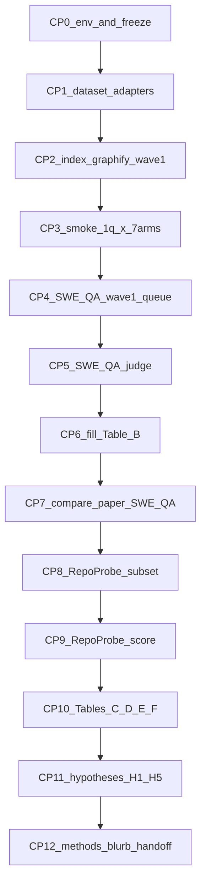

# Phase 2 Agent Evaluation Runbook

**Branch:** `phase2-eval`  
**Role:** Executor follows **one checkpoint (CP) at a time**. Update Status → run steps → paste Results log → **STOP** and ask the human to verify before the next CP.  
**Theory source (do not replace):** [`PHASE2_REPO_QA_EVAL_PLAN.md`](PHASE2_REPO_QA_EVAL_PLAN.md)  
**Phase 1 (prior only — never mix metrics):** [`analysis/README.md`](analysis/README.md), [`analysis/nov3_lib.py`](analysis/nov3_lib.py) (`ARMS`)

**Official benchmark READMEs (commands below follow these):**

| Suite | Upstream | Docs |
|-------|----------|------|
| SWE-QA | [peng-weihan/SWE-QA-Bench](https://github.com/peng-weihan/SWE-QA-Bench) | [README](https://github.com/peng-weihan/SWE-QA-Bench/blob/master/README.md) · HF [swe-qa/SWE-QA-Benchmark](https://huggingface.co/datasets/swe-qa/SWE-QA-Benchmark) · judge [`Benchmark construction/score/llm-as-a-judge.py`](https://github.com/peng-weihan/SWE-QA-Bench/blob/master/Benchmark%20construction/score/llm-as-a-judge.py) |
| RepoProbe | [Tencent-Hunyuan/RepoProbe](https://github.com/Tencent-Hunyuan/RepoProbe) | [README](https://github.com/Tencent-Hunyuan/RepoProbe/blob/main/README.md) · [`docs/AGENT_INTEGRATION.md`](https://github.com/Tencent-Hunyuan/RepoProbe/blob/main/docs/AGENT_INTEGRATION.md) · `scorer.py` / `evaluator.py` |

Suggested local clones (gitignored / outside thesis tree is fine):

- `../external/SWE-QA-Bench`
- `../external/RepoProbe`

---

## How to use this document

1. Work only on branch `phase2-eval`.
2. Mark the current CP `in_progress` in the Progress board and in the CP header.
3. Complete **Success criteria**, fill **Results log**, then set status `done`.
4. Tell the human what was verified and wait for approval before starting the next CP.
5. If blocked (missing data, Ollama down, index missing), set `blocked`, write why in Results log, stop.

**Canonical 7 arms** (same as Nov 3 / `nov3_lib.ARMS`):

`ALWAYS_GRAPH` · `ALWAYS_RAG` · `ALWAYS_LC` · `GASR` · `GAPA` · `SELF_ROUTE` · `PREASSESS`

**Locked Wave 1 scope**

| Suite | Scope |
|-------|--------|
| SWE-QA | `flask` + `requests` + `pytest` JSONL from `SWE-QA-Bench/Benchmark/` (**48×3 = 144** Qs; HF splits `flask`/`requests`/`pytest`) × 7 arms |
| RepoProbe | All **8** `primary_language=Python` repos from `repos_info.json` (CSV under `dataset/<name>.csv`) after Table B; expand later if needed |
| Generator | Our pipeline: `qwen3.5:9b` via Ollama (not SWE-QA’s Voyage/OpenAI baselines) |
| Judge | Must **≠** generator; SWE-QA uses their `llm-as-a-judge.py` protocol; RepoProbe uses `scorer.py` / `SCORING_MODEL` |

**Resume rules (Phase 1 harness — reuse for Phase 2 outs)**

| Mechanism | Path / behavior |
|-----------|-----------------|
| Per-job results | `<out>/results.jsonl` — re-run skips completed `task_id`s |
| Job identity | `<out>/job.json` must match or resume is refused |
| Queue status | `<job_out>/queue_status.json` (`complete` / `incomplete` / …) |
| Clean stop | `<data>/queue/STOPPED` — delete marker to continue |
| Entry | `eval_harness/wrappers/run_queue.sh` → `python -m harness.queue` |

Phase 2 outs live under: `eval_harness/data/runs/phase2-*` (create as needed).

---

## Official upstream setup (from READMEs)

### SWE-QA-Bench ([README](https://github.com/peng-weihan/SWE-QA-Bench/blob/master/README.md))

**Layout that matters**

| Path | Role |
|------|------|
| `Benchmark/*.jsonl` | Released Q–A (e.g. `flask.jsonl`, `requests.jsonl`, `pytest.jsonl`) — **48 lines/repo**; fields observed: `question`, `answer` |
| `repo_commit.txt` | `https://github.com/... <commit>` lines for `clone_repos.sh` |
| `clone_repos.sh` | Clones into `./datas/repos/<repo_name>` and `git checkout` pinned commit |
| `Benchmark construction/score/llm-as-a-judge.py` | Official 5-dim judge (Correctness, Completeness, Relevance, Clarity, Reasoning), each 1–20 → /100 |
| HF `swe-qa/SWE-QA-Benchmark` | Same 720 Qs; `load_dataset(..., split="flask")` etc. |

**Pinned Wave 1 commits** (from upstream `repo_commit.txt`, short SHAs as published):

| Repo | URL | Commit |
|------|-----|--------|
| flask | https://github.com/pallets/flask | `85c5d93` |
| requests | https://github.com/psf/requests | `46e939b` |
| pytest | https://github.com/pytest-dev/pytest | `5989efe` |

**Official install / clone (bash):**

```bash
git clone https://github.com/peng-weihan/SWE-QA-Bench.git ../external/SWE-QA-Bench
cd ../external/SWE-QA-Bench
# Python 3.12 + uv (README prerequisites)
uv sync
# optional baselines need OpenAI + Voyage — we do NOT require that for our 7-arm pipeline
# uv sync --extra baseline
./clone_repos.sh   # reads repo_commit.txt → datas/repos/
# Wave 1 only: either run full clone_repos.sh, or clone the three lines above manually to datas/repos/{flask,requests,pytest}
```

**Official judge env** (from `llm-as-a-judge.py`):

| Env | Purpose |
|-----|---------|
| `EVAL_LLM_BASE_URL` | Azure OpenAI endpoint |
| `EVAL_LLM_API_VERSION` | API version |
| `EVAL_LLM_API_KEY` | Key |
| `EVAL_LLM_MODEL_NAME` | Judge model |
| `EVAL_CANDIDATE_PATH` / `EVAL_CANDIDATE_PATHS` / `EVAL_CANDIDATE_DIR` | Candidate answer file(s) |
| `EVAL_REFERENCE_PATH` | Gold / reference JSONL |
| `EVAL_OUTPUT_PATH` / `EVAL_OUTPUT_DIR` | Score outputs |
| `EVAL_REPO_FILTER` | Optional comma-separated repo filter |
| `EVAL_MAX_WORKERS` | Parallelism |

Our generator can stay on Ollama; the **judge** may use Azure/OpenAI-compatible API matching this script, or a documented local adaptation of the same prompt — record which in FREEZE.md.

**HF load (alternative to JSONL files):**

```python
from datasets import load_dataset
flask_ds = load_dataset("swe-qa/SWE-QA-Benchmark", split="flask")  # 48
# fields: question, answer
```

### RepoProbe ([README](https://github.com/Tencent-Hunyuan/RepoProbe/blob/main/README.md) + [AGENT_INTEGRATION.md](https://github.com/Tencent-Hunyuan/RepoProbe/blob/main/docs/AGENT_INTEGRATION.md))

**Layout that matters**

| Path | Role |
|------|------|
| `dataset/*.csv` | One CSV per repo; columns: `repo_name`, `question_id`, `discussion_id`, `taxonomy`, `difficulty`, `question`, `answer`, `checklist` |
| `repos_info.json` | 50 repos + snapshot `git.head` (must evaluate at these commits) |
| `scripts_agent/fetch_repos.sh` | Clone/checkout + repomix → `candidate_repos/` |
| `scripts_agent/eval_models_multi_repo.sh` | Docker agent eval orchestrator |
| `evaluator.py` | Container runner |
| `scorer.py` | Checklist LLM judge → /10 (knowledge ≤9 + clarity 1) |
| `agent_configs/agent.json` | Declares agent `command`, gateway, env |
| `docs/AGENT_INTEGRATION.md` | Container contract |

**Python subset from `repos_info.json` (`primary_language=Python`) — default Phase 2 subset (8):**

`FieldStation42`, `adk-python`, `agent-framework`, `browser-use`, `crawl4ai`, `docling`, `sglang`, `yasb`  
(CSV filenames match short names under `dataset/`.)

**Official Quick Start (bash):**

```bash
git clone https://github.com/Tencent-Hunyuan/RepoProbe.git ../external/RepoProbe
cd ../external/RepoProbe
# Python 3.11+, Docker, Node.js 20+ (repomix)
pip install -r requirements.txt
cd agent_configs && bash build_base_image.sh && cd ..
export DATASET_DIR=./dataset
bash scripts_agent/fetch_repos.sh   # uses repos_info.json → candidate_repos/
# Full Docker agent eval (paper-style scaffolding):
export OPENAI_API_KEY=...
export OPENAI_BASE_URL=...          # optional
export MODELS=gpt-5.2               # models under test in their harness
export SCORING_MODEL=gpt-5.2        # judge; can differ via OPENAI_SCORING_* 
bash scripts_agent/eval_models_multi_repo.sh
# Single-repo smoke (from AGENT_INTEGRATION checklist):
# MODELS=<model> DATASET_DIR=./dataset/adk-python.csv bash scripts_agent/eval_models_multi_repo.sh
```

**Container contract** (if using their Docker path): repo at `/app/repo`, question in `/tmp/prompt/prompt.txt`, **final answer on stdout only**, exit 0. Declare scaffolding in `agent_configs/agent.json`.

**Our default for thesis tables:** **scorer-on-pipeline** — produce answers with our 7 arms on host (indexed repos at `repos_info` SHAs), then grade with RepoProbe `scorer.py` / checklist protocol. State scaffolding explicitly in FREEZE.md. Scores are **not** head-to-head with paper GPT-5.2 (different scaffolding). Optionally later wire `agent.json` to call our HTTP `/generate` for Docker-comparable runs.

**Key RepoProbe env vars** (README table): `OPENAI_API_KEY`, `OPENAI_BASE_URL`, `OPENAI_SCORING_API_KEY`, `OPENAI_SCORING_BASE_URL`, `MODELS`, `SCORING_MODEL`, `DATASET_DIR`, `CANDIDATE_REPO_DIR`, `REPO_JSON_PATH`, `CACHE_DIR`, `OUTPUT_DIR`, `NUM_ITERATIONS`, `AGENT_CONFIG`, `AGENT_TIMEOUT`.

---

## Progress board

- [ ] **CP0** — Env + freeze SHAs
- [ ] **CP1** — Dataset adapters (SWE-QA Wave 1 + RepoProbe subset)
- [ ] **CP2** — Index + Graphify Wave 1 repos
- [ ] **CP3** — Smoke: 1 question × 7 arms
- [ ] **CP4** — SWE-QA Wave 1 full queue
- [ ] **CP5** — SWE-QA LLM judge (/100)
- [ ] **CP6** — Fill Table B
- [ ] **CP7** — Compare to SWE-QA paper
- [ ] **CP8** — RepoProbe Python-8 fetch + run (`fetch_repos.sh` / our queue)
- [ ] **CP9** — RepoProbe `scorer.py` checklist (/10)
- [ ] **CP10** — Fill Tables C–F
- [ ] **CP11** — Score hypotheses H1–H5
- [ ] **CP12** — Methods blurb + handoff

---

## Paper anchors (Table A — literature, not our runs)

Sources: SWE-QA [arXiv:2509.14635v2](https://arxiv.org/abs/2509.14635) · RepoProbe [arXiv:2608.04783v2](https://arxiv.org/abs/2608.04783).

### A1. SWE-QA (illustrative paper numbers)

| System (paper) | Overall /100 (example) | Note |
|----------------|------------------------|------|
| Direct (no repo context) | ~50–66 depending on model | Lowest; need code context |
| + Function-Chunking RAG | e.g. Qwen3-Coder-30B **50.80 → 63.40** (+12.6) | Large RAG gain |
| + Sliding-Window RAG | Similar large gains | — |
| + SWE-agent / OpenHands | Often highest among open stacks | Agent > RAG |
| Cursor / Tongyi | ~69–71 | Commercial reference |

### A2. RepoProbe (paper Table 3, %)

| Model | Overall | Knowledge | Clarity | Perfect Solve |
|-------|---------|-----------|---------|---------------|
| GPT-5.2 | **62.7** | **60.3** | **84.7** | **26.0** |
| Claude Opus 4.6 | 62.1 | 60.2 | 79.0 | 27.5 |
| GLM-5 (best open in table) | 54.8 | 52.9 | 72.2 | 21.3 |

**Signature to reproduce qualitatively:** Clarity ≫ Knowledge; Perfect Solve remains moderate.

**Hard rules for comparisons**

- Never average SWE-QA **/100** with RepoProbe **/10**.
- Paper systems are **anchors** (different scaffolding / models) — primary claim is **routing cost–quality**, not beating Cursor absolute /100 or GPT-5.2 head-to-head.
- Nov 3 Loc Acc@k is **Phase 1 only** — do not paste into Tables B–F.

---

## Checkpoint ladder



---

### CP0 — Env and freeze SHAs

**Status:** pending

**Why this step:** Upstream READMEs pin commits (`repo_commit.txt`, `repos_info.json`). Evaluating `HEAD` invalidates checklists/gold. Also freeze our generator/judge digests.

**What the agent does:**

1. Confirm branch: `git rev-parse --abbrev-ref HEAD` → `phase2-eval`; record full HEAD.
2. Confirm Ollama + `qwen3.5:9b` for **generation**.
3. Clone upstream benches (if missing) per **Official upstream setup** above.
4. Record in `docs/phase2_runs/FREEZE.md`:
   - `pipeline_commit`, `generator_model`, `judge_model` (SWE-QA + RepoProbe judges), `token_budget=1300`
   - SWE-QA Wave 1: flask/`85c5d93`, requests/`46e939b`, pytest/`5989efe` + path to `SWE-QA-Bench` checkout + `Benchmark/{flask,requests,pytest}.jsonl` line counts
   - RepoProbe: list of 8 Python short names + each `snapshot.git.head` from `repos_info.json` + path to RepoProbe checkout
   - Scaffolding note: `scorer-on-pipeline` (default) vs Docker `agent.json` if used
5. Verify judge credentials exist for later CPs (`EVAL_LLM_*` and/or `OPENAI_API_KEY` / `OPENAI_SCORING_*`) — do not need Voyage unless running SWE-QA’s own RAG baselines.

**Commands:**

```bash
git rev-parse --abbrev-ref HEAD && git rev-parse HEAD
curl -s http://127.0.0.1:11434/api/tags
mkdir -p docs/phase2_runs ../external
# clone if needed:
# git clone https://github.com/peng-weihan/SWE-QA-Bench.git ../external/SWE-QA-Bench
# git clone https://github.com/Tencent-Hunyuan/RepoProbe.git ../external/RepoProbe
wc -l ../external/SWE-QA-Bench/Benchmark/flask.jsonl \
      ../external/SWE-QA-Bench/Benchmark/requests.jsonl \
      ../external/SWE-QA-Bench/Benchmark/pytest.jsonl
# expect 48 lines each
python -c "import json; d=json.load(open('../external/RepoProbe/repos_info.json')); print(sum(1 for x in d if x.get('primary_language')=='Python'))"
```

**Artifacts to write:** `docs/phase2_runs/FREEZE.md`

**Success criteria:**

- [ ] On `phase2-eval`
- [ ] Upstream clones present (or documented alternate paths)
- [ ] FREEZE.md has Wave 1 SHAs matching `repo_commit.txt` and RepoProbe Python heads
- [ ] Ollama reachable; judge API plan documented

**Results log:** _(paste HEAD, clone paths, line counts, FREEZE path)_

**Paper comparison (if any):** none yet — freeze only.

**STOP:** Ask human to verify FREEZE.md before CP1.

---

### CP1 — Dataset adapters (SWE-QA Wave 1 + RepoProbe subset)

**Status:** pending

**Why this step:** Wire official data formats into our harness. Phase 1 `datasets.toml` only has LocAgent HF localization sets — wrong task type.

**What the agent does:**

1. **SWE-QA loader** from `Benchmark/{flask,requests,pytest}.jsonl` (or HF splits):
   - Map each line → `task_id` (e.g. `flask-017`), `repo`, `question`, `gold_answer` (= `answer`).
   - Official JSONL fields are **`question` + `answer` only** (no taxonomy column in release files). For Table D stratification, either skip until labeled, or join an optional local taxonomy map — do **not** invent labels.
2. **RepoProbe loader** from `dataset/<shortname>.csv` for the 8 Python repos:
   - Use columns: `question_id`, `repo_name`, `taxonomy`, `difficulty`, `question`, `answer`, `checklist` (weighted tiered items as in README).
3. Add `eval_harness/configs/datasets.toml` entries (names e.g. `swe-qa-w1`, `repoprobe-py8`) pointing at those paths.
4. Free-form answer path: Phase 2 jobs must **not** set Nov 3 `answer_locations_instruction = true`.
5. Skeleton queues: `eval_harness/queues/phase2-sweqa-w1.toml`, `phase2-repoprobe-py.toml`.

**Commands:**

```bash
# Count SWE-QA Wave 1
python -c "from pathlib import Path; b=Path('../external/SWE-QA-Bench/Benchmark');
print({p.stem: sum(1 for _ in open(p,encoding='utf-8')) for p in b.glob('{flask,requests,pytest}.jsonl')})"
# Count RepoProbe Python CSVs
python -c "import csv,json; from pathlib import Path
info=json.load(open('../external/RepoProbe/repos_info.json'))
py=[x['name'].split('/')[-1] for x in info if x.get('primary_language')=='Python']
root=Path('../external/RepoProbe/dataset');
print({n: sum(1 for _ in open(root/f'{n}.csv',encoding='utf-8'))-1 for n in py if (root/f'{n}.csv').exists()})"
```

**Artifacts to write:** harness loaders + config entries; queue skeletons; Results log with counts.

**Success criteria:**

- [ ] SWE-QA Wave 1 loader returns **144** tasks
- [ ] RepoProbe loader returns documented Σ over 8 CSVs
- [ ] Sample task dumps show gold `answer` / `checklist` fields
- [ ] Free-form prompt path exists

**Results log:** _(counts, module paths, one sample task_id per suite)_

**Paper comparison (if any):** none — infrastructure.

**STOP:** Ask human to verify adapter design before CP2.

---

### CP2 — Index + Graphify Wave 1 repos

**Status:** pending

**Why this step:** Always-GRAPH / GASR / GAPA need graphs. SWE-QA README clones via `clone_repos.sh` into `datas/repos/` — index **those** checkouts (or identical SHAs), not random `main`.

**What the agent does:**

1. From `SWE-QA-Bench`: run `./clone_repos.sh` **or** manually clone Wave 1 three repos to matching SHAs under `datas/repos/{flask,requests,pytest}`.
2. Build Chroma indexes with `CHROMA_PATH` pointing at harness scratch dirs; enable call-graph sidecar (`call_graph.json`) for graph retrieval mode.
3. Ensure Graphify / `graph.json` available for GASR expand (`docs/GASR_LIVE_RUN.md`).
4. Record paths in `docs/phase2_runs/INDEXES.md`.
5. Indexes must exist **before** queue (Phase 1 preflight rule).

**Commands:**

```bash
cd ../external/SWE-QA-Bench
# full: ./clone_repos.sh
# or Wave 1 only:
mkdir -p datas/repos
git clone https://github.com/pallets/flask datas/repos/flask && git -C datas/repos/flask checkout 85c5d93
git clone https://github.com/psf/requests datas/repos/requests && git -C datas/repos/requests checkout 46e939b
git clone https://github.com/pytest-dev/pytest datas/repos/pytest && git -C datas/repos/pytest checkout 5989efe
# then index each repo with thesis pipeline (record exact CLI used)
```

**Artifacts to write:** indexes + `docs/phase2_runs/INDEXES.md`

**Success criteria:**

- [ ] `git -C datas/repos/flask rev-parse --short HEAD` matches freeze (`85c5d93`…)
- [ ] Same for requests / pytest
- [ ] Graph artifacts present for GRAPH arms
- [ ] Paths recorded

**Results log:** _(index paths, graph paths, checked-out SHAs)_

**Paper comparison (if any):** none.

**STOP:** Ask human to verify indexes before CP3.

---

### CP3 — Smoke: 1 question × 7 arms

**Status:** pending

**Why this step:** Prove free-form generation + routing telemetry (tokens, route RAG/GRAPH/LC) before burning a full Wave 1 queue.

**What the agent does:**

1. Pick one fixed Wave 1 question (record `task_id` in FREEZE.md).
2. Run all 7 arms into `eval_harness/data/runs/phase2-smoke/` (or harness smoke helper if extended).
3. Confirm each arm writes a result line with: free-form `answer`/`output`, injected tokens, route, hops if any.
4. Optionally exercise resume: kill mid-job and re-run same `--out` (Phase 1 pattern in `harness.smoke`).

**Commands:**

```bash
# Prefer harness smoke once Phase 2 arm/dataset wired, e.g.:
# PYTHONPATH=eval_harness/src python -m harness.smoke ... --out eval_harness/data/runs/phase2-smoke
# Or single-arm:
# PYTHONPATH=eval_harness/src python -m harness.run ... --out eval_harness/data/runs/phase2-smoke/<arm>
```

**Artifacts to write:** `eval_harness/data/runs/phase2-smoke/**/results.jsonl`

**Success criteria:**

- [ ] 7 arms produced answers for the same `task_id`
- [ ] Token / route fields present
- [ ] No Mem0 dependency
- [ ] Resume skip works if tested

**Results log:** _(paths; one-line route/token summary per arm)_

**Paper comparison (if any):** none — smoke only.

**STOP:** Ask human to approve smoke before CP4.

---

### CP4 — SWE-QA Wave 1 full queue

**Status:** pending

**Why this step:** Produce the raw Phase 2 answers for Table B under resume-safe queue semantics.

**What the agent does:**

1. Finalize `eval_harness/queues/phase2-sweqa-w1.toml`: one job per arm (or arm×repo), `model = "qwen3.5:9b"`, dataset = SWE-QA Wave 1, **no** `answer_locations_instruction` (use explanation prompt).
2. Set `hold_after` on the first completed arm if human wants a mid-queue check (mirrors Nov 3 GAPA hold).
3. Start/resume via queue wrapper (adjust `--queue` to the Phase 2 file):

```bash
# From Linux/Ubuntu harness host (bash), pattern from run_queue.sh:
# Edit wrapper or pass --queue explicitly to harness.queue pointing at phase2-sweqa-w1.toml
export PYTHONPATH="<worktree>/eval_harness/src"
python -m harness.queue \
  --profile "<worktree>/eval_harness/profiles/ubuntu-4080.toml" \
  --queue "<worktree>/eval_harness/queues/phase2-sweqa-w1.toml" \
  --configs "<worktree>/eval_harness/configs" \
  --cwd "<main_data_tree>"
```

4. Monitor `<data>/queue/` heartbeats; if `STOPPED` appears, read reason, fix, delete marker, resume.
5. Do not start CP5 until all Wave 1 jobs are `complete` in `queue_status.json`.

**Artifacts to write:** `eval_harness/data/runs/phase2-sweqa-w1/` (per-job folders with `results.jsonl`, `queue_status.json`)

**Success criteria:**

- [ ] Expected task×arm count completed (144 × 7 unless job packing differs — document)
- [ ] Resume after interrupt works
- [ ] No silent missing-graph LC-only collapse on GRAPH arms (spot-check hops)

**Results log:** _(queue path, job ids, completion counts, wall time)_

**Paper comparison (if any):** none until judged.

**STOP:** Ask human to verify completion before CP5.

---

### CP5 — SWE-QA LLM judge (/100)

**Status:** pending

**Why this step:** Official scoring is upstream `Benchmark construction/score/llm-as-a-judge.py`: five dims 1–20 → **/100** vs gold (`question` + reference `answer` + candidate). Script docstring names dims Correctness, Completeness, Relevance, Clarity, **Reasoning** (paper/tables often say Coherence for the fifth).

**What the agent does:**

1. Export our Wave 1 candidates into the file layout expected by `llm-as-a-judge.py` (or wrap it): candidate answers keyed to the same questions as `Benchmark/*.jsonl`.
2. Set judge env from upstream script (`EVAL_LLM_BASE_URL`, `EVAL_LLM_API_VERSION`, `EVAL_LLM_API_KEY`, `EVAL_LLM_MODEL_NAME`, `EVAL_REFERENCE_PATH`, `EVAL_CANDIDATE_PATH` / `EVAL_CANDIDATE_DIR`, `EVAL_OUTPUT_PATH`, optional `EVAL_REPO_FILTER=flask,requests,pytest`).
3. Judge model **≠** generator; record both in FREEZE.md.
4. Prefer paper’s multi-vote if affordable; else single-pass and label tables `single-judge`.
5. Copy/normalize scores into `eval_harness/data/reports/phase2_sweqa_w1/answer_scores_sweqa.jsonl` + CSV for Table B.

**Commands:**

```bash
cd ../external/SWE-QA-Bench
export EVAL_LLM_BASE_URL=...
export EVAL_LLM_API_VERSION=...
export EVAL_LLM_API_KEY=...
export EVAL_LLM_MODEL_NAME=...   # judge ≠ qwen3.5:9b
export EVAL_REFERENCE_PATH=Benchmark/flask.jsonl   # or combined refs
export EVAL_CANDIDATE_PATH=/path/to/our_flask_candidates.jsonl
export EVAL_OUTPUT_PATH=/path/to/scores_flask.jsonl
export EVAL_REPO_FILTER=flask,requests,pytest
# run via uv/python as in their tree, e.g.:
# uv run python "Benchmark construction/score/llm-as-a-judge.py"
```

**Dimension meanings (script / paper):**

| Dim | Meaning |
|-----|---------|
| Correctness | Factual accuracy vs gold |
| Completeness | Covers aspects of the question / reference |
| Relevance | On-topic |
| Clarity | Organization / readability |
| Reasoning | Logical reasoning (aka Coherence in some tables) |

**Success criteria:**

- [ ] Scores produced with upstream judge (or documented prompt-compatible port)
- [ ] Every Wave 1 answer scored or explicitly skipped
- [ ] Arm means ready for Table B; judge model in FREEZE.md

**Results log:** _(judge model, env used, score paths, mean Overall/100 per arm draft)_

**Paper comparison (if any):** defer narrative to CP7.

**STOP:** Ask human to spot-check a few judged examples before CP6.

---

### CP6 — Fill Table B

**Status:** pending

**Why this step:** Table B is the main SWE-QA Phase 2 result for the thesis.

**What the agent does:**

1. Join answer scores with routing/token metrics from `results.jsonl` (injected tokens, token% vs Always-LC, %RAG/%GRAPH/%LC, wall ms).
2. Fill **Table B** below and write CSV: `docs/phase2_runs/table_b_sweqa_w1.csv`.
3. Update FREEZE stamp line under the table.

**Success criteria:**

- [ ] All 7 arms filled
- [ ] CSV committed or saved under `docs/phase2_runs/`
- [ ] Token% denominator = Always-LC mean tokens

**Results log:** _(link to CSV; any missing cells)_

**Paper comparison (if any):** short note of expected direction: GASR/GAPA tokens ≪ Self-Route/PREASSESS; Overall non-inferior; %LC↓ with %GRAPH>0 on How/multi-hop — mark whether observed.

**STOP:** Ask human to review Table B before CP7.

---

### CP7 — Compare to SWE-QA paper

**Status:** pending

**Why this step:** Situate our Always-RAG / GASR against literature anchors without claiming identical scaffolding.

**What the agent does:**

1. Write `docs/phase2_runs/COMPARE_SWE_QA.md` with:
   - Our Always-RAG Overall/100 vs paper FC-RAG gain narrative (RAG ≫ Direct)
   - Our GASR/GAPA vs Self-Route: token cut and quality delta (H1 preview)
   - Explicit statement: **not** claiming to beat Cursor ~69–71 under their agent stack
2. Fill Table E draft numbers from Table B + paper anchor row.

**Success criteria:**

- [ ] COMPARE_SWE_QA.md exists with 1–2 paragraphs + bullet contrasts
- [ ] Table E partially filled

**Results log:** _(path to COMPARE doc)_

**Paper comparison:** required output of this CP.

**STOP:** Ask human to approve narrative before RepoProbe (CP8).

---

### CP8 — RepoProbe Python subset run

**Status:** pending

**Why this step:** Discussion-based architecture QA (RepoProbe README). Pin snapshots from `repos_info.json` via `fetch_repos.sh` — never score against current upstream `HEAD`.

**What the agent does:**

1. In RepoProbe tree: `pip install -r requirements.txt`; `bash agent_configs/build_base_image.sh` only if using Docker agent path.
2. `export DATASET_DIR=./dataset` and `bash scripts_agent/fetch_repos.sh` (clones to `candidate_repos/` at pinned commits; generates repomix). Exclude any repo whose snapshot disappeared (README rule).
3. Restrict evaluation to the **8 Python** CSV names in FREEZE.md.
4. **Default (thesis):** index `candidate_repos/<repo>` with our pipeline; queue `eval_harness/queues/phase2-repoprobe-py.toml` → `eval_harness/data/runs/phase2-repoprobe-py/` for all 7 arms (free-form).
5. **Optional Docker:** point `agent_configs/agent.json` at a wrapper that calls our `/generate` (AGENT_INTEGRATION.md: `/app/repo`, `/tmp/prompt/prompt.txt`, stdout-only answer), then `MODELS=... DATASET_DIR=... bash scripts_agent/eval_models_multi_repo.sh`.

**Commands:**

```bash
cd ../external/RepoProbe
pip install -r requirements.txt
export DATASET_DIR=./dataset
bash scripts_agent/fetch_repos.sh
# git -C candidate_repos/adk-python rev-parse HEAD  # must match repos_info.json
# Then our harness queue, or Docker:
# export OPENAI_API_KEY=... MODELS=...
# DATASET_DIR=./dataset/adk-python.csv bash scripts_agent/eval_models_multi_repo.sh
```

**Success criteria:**

- [ ] Fetched repos match FREEZE snapshot SHAs
- [ ] n_questions (sum of 8 CSVs) documented; 7-arm run or Docker eval complete
- [ ] Scaffolding mode recorded (`scorer-on-pipeline` vs Docker `agent.json`)

**Results log:** _(n_repos, n_questions, out paths, scaffolding)_

**Paper comparison (if any):** none until scored.

**STOP:** Ask human before CP9.

---

### CP9 — RepoProbe checklist scorer (/10)

**Status:** pending

**Why this step:** Official grading is `scorer.py` checklist verification (README): **/10** = knowledge ≤9 + clarity 1 → Overall%, Knowledge%, Clarity%, Perfect Solve% (full 10/10). Tiered rubrics are in the CSV `checklist` column.

**What the agent does:**

1. **Preferred:** grade host-generated arm answers with RepoProbe `scorer.py` / evaluator scoring; set `SCORING_MODEL` ≠ generator; use `OPENAI_SCORING_API_KEY` / `OPENAI_SCORING_BASE_URL` if judge endpoint differs.
2. If Docker `eval_models_multi_repo.sh` already scored, export from `CACHE_DIR` / `OUTPUT_DIR` (defaults `cache_experiments`, `agent_results`).
3. Aggregate to `eval_harness/data/reports/phase2_repoprobe_py/checklist_scores.csv`.
4. Confirm Clarity% > Knowledge% pattern (README key finding).
5. FREEZE.md: scaffolding + `SCORING_MODEL` (AGENT_INTEGRATION comparability warning).

**Commands:**

```bash
cd ../external/RepoProbe
export OPENAI_API_KEY=...
export OPENAI_SCORING_API_KEY=...    # optional separate judge
export SCORING_MODEL=...             # judge ≠ generator
# End-to-end Docker eval includes scoring; for host answers, invoke scorer/evaluator
# as adapted — document the exact invocation in Results log.
```

**Success criteria:**

- [ ] Checklist scores for all completed tasks (or documented skips)
- [ ] Arm aggregates for Table C
- [ ] FREEZE.md states scaffolding + scoring model

**Results log:** _(score paths; mean Overall/Knowledge/Clarity/Perfect per arm)_

**Paper comparison (if any):** Clarity ≫ Knowledge vs README (GPT-5.2 84.7 vs 60.3) — **pattern** only; not absolute match to 62.7 Overall under paper scaffolding.

**STOP:** Ask human to spot-check checklists before CP10.

---

### CP10 — Fill Tables C–F

**Status:** pending

**Why this step:** Stratified and design-contrast tables for the Evaluation section.

**What the agent does:**

1. Fill Tables C, D1, D2, E, F in this runbook.
2. Export CSVs under `docs/phase2_runs/` (`table_c_*.csv`, `table_d_*.csv`, `table_e_*.csv`, `table_f_*.csv`).
3. Expected GRAPH absorb: largest on SWE-QA **How** and RepoProbe **Architecture** / multi-file **Implementation**.

**Success criteria:**

- [ ] C–F filled or explicit N/A with reason
- [ ] CSVs written

**Results log:** _(CSV paths)_

**Paper comparison (if any):** Table E literature row vs our Always-RAG/GASR.

**STOP:** Ask human before hypothesis scoring (CP11).

---

### CP11 — Score hypotheses H1–H5

**Status:** pending

**Why this step:** Convert tables into pass/fail against Phase 2 hypotheses from the scientific plan.

| ID | Hypothesis | Falsifier | Result (pass/fail) | Evidence |
|----|------------|-----------|--------------------|----------|
| H1 | GASR ≥30% mean token cut vs Self-Route at non-inferior SWE-QA Overall/100 (tol. e.g. −3 pts) | Token Δ &lt; 30% or quality drop beyond tol. | | |
| H2 | GAPA matches/beats GASR on gate-token economy vs PREASSESS | Gate cost higher without quality gain | | |
| H3 | On RepoProbe, GASR/GAPA Knowledge% ≥ Self-Route/PREASSESS at lower tokens | Knowledge flat/down; only Clarity up | | |
| H4 | %LC(GASR) &lt; %LC(Self-Route) on How / Architecture strata | LC rate not lower | | |
| H5 | Always-GRAPH does not dominate GASR on tokens | Always-GRAPH cheaper at equal quality | | |

**What the agent does:** Write `docs/phase2_runs/HYPOTHESES.md` with the table filled and short justifications.

**Success criteria:**

- [ ] All five rows filled pass/fail/inconclusive
- [ ] Numbers cite Table B/C/D cells

**Results log:** _(path to HYPOTHESES.md)_

**STOP:** Ask human before final handoff (CP12).

---

### CP12 — Methods blurb + handoff

**Status:** pending

**Why this step:** Close the loop for the paper Evaluation section and slides.

**What the agent does:**

1. Confirm Methods blurb in [`PHASE2_REPO_QA_EVAL_PLAN.md`](PHASE2_REPO_QA_EVAL_PLAN.md) §9 still matches what was run (update FREEZE digest if models/SHAs differ).
2. List artifact index in `docs/phase2_runs/README.md` (tables, scores, COMPARE, HYPOTHESES).
3. Note companion slide path if present: `docs/slides/PHASE2_SWE_QA_RepoProbe_one_v2.pptx`.
4. Mark all Progress board items done; remind human Phase 1 Nov 3 remains localization-only.

**Success criteria:**

- [ ] `docs/phase2_runs/README.md` lists all artifacts
- [ ] Progress board all checked
- [ ] Human acknowledged handoff

**Results log:** _(artifact index)_

**STOP:** Planner confirms Phase 2 eval execution complete.

---

## Live result tables (fill during CPs)

### Table B — Phase 2 main (SWE-QA Wave 1) — fill in CP6

*n = ___ · generator = ___ · judge = ___ · stamp = ___*

| Arm | Overall/100 | Corr | Comp | Rel | Clar | Coh | tokens mean | token% vs LC | %RAG | %GRAPH | %LC | wall ms |
|-----|-------------|------|------|-----|------|-----|-------------|--------------|------|--------|-----|---------|
| Always-RAG | | | | | | | | | | | | |
| Always-GRAPH | | | | | | | | | | | | |
| Always-LC | | | | | | | | | | | | |
| Self-Route | | | | | | | | | | | | |
| PREASSESS | | | | | | | | | | | | |
| GASR | | | | | | | | | | | | |
| GAPA | | | | | | | | | | | | |

**Expected direction:** GASR/GAPA tokens ≪ Self-Route/PREASSESS; Overall non-inferior; %LC↓ with %GRAPH>0 on How/multi-hop.

**Vs paper (CP7):** RAG should beat no-context narrative; do not require matching Cursor ~69–71.

---

### Table C — RepoProbe subset — fill in CP10

*n = ___ · scaffolding = scorer-on-pipeline · stamp = ___*

| Arm | Overall% | Knowledge% | Clarity% | Perfect% | tokens mean | %LC | %GRAPH |
|-----|----------|------------|----------|----------|-------------|-----|--------|
| Always-RAG | | | | | | | |
| Always-GRAPH | | | | | | | |
| Always-LC | | | | | | | |
| Self-Route | | | | | | | |
| PREASSESS | | | | | | | |
| GASR | | | | | | | |
| GAPA | | | | | | | |

**Vs paper (A2):** Expect Clarity ≫ Knowledge for all arms; Perfect Solve moderate. Absolute % need not match GPT-5.2 **62.7**.

---

### Table D — Stratified quality — fill in CP10

**Note:** Official SWE-QA `Benchmark/*.jsonl` release rows are only `question`/`answer`. Fill D1 only if a taxonomy map is added; otherwise mark N/A and stratify RepoProbe D2 via CSV `taxonomy`.

**D1. SWE-QA Level-1 × arm (Overall/100)**

| Arm | What | Why | Where | How |
|-----|------|-----|-------|-----|
| Always-RAG | | | | |
| Always-GRAPH | | | | |
| Always-LC | | | | |
| Self-Route | | | | |
| PREASSESS | | | | |
| GASR | | | | |
| GAPA | | | | |

**D2. RepoProbe category × arm (Overall%)**

| Arm | Architecture | Business Logic | Implementation |
|-----|--------------|----------------|----------------|
| Always-RAG | | | |
| Always-GRAPH | | | |
| Always-LC | | | |
| Self-Route | | | |
| PREASSESS | | | |
| GASR | | | |
| GAPA | | | |

**Expected:** largest GRAPH absorb on How / Architecture / Implementation multi-file questions.

---

### Table E — Fairness vs SWE-QA paper RAG — fill in CP7/CP10

| System | Overall/100 | tokens mean | Note |
|--------|-------------|-------------|------|
| Paper Function-Chunking RAG (same model family if possible) | | — | Literature anchor |
| Our Always-RAG | | | Same Wave 1 questions |
| Our GASR | | | Routing + graph |

---

### Table F — Design contrasts — fill in CP10

| Contrast | Pair | Metric focus | Result (fill after run) |
|----------|------|--------------|-------------------------|
| Gated graph helps? | Self-Route vs GASR | Overall + tokens + %LC | |
| Gated graph helps? | PREASSESS vs GAPA | Overall + tokens + %LC | |
| Gate timing | GASR vs GAPA | Gate tokens + Pareto | |
| Gate timing | Self-Route vs PREASSESS | Overall + LC rate | |
| Always vs gated | Always-GRAPH vs GASR | tokens at similar Overall | |
| Bounds | Always-RAG vs Always-LC | Envelope | |

---

## Quick reference paths

| Role | Path |
|------|------|
| Scientific plan | `docs/PHASE2_REPO_QA_EVAL_PLAN.md` |
| This runbook | `docs/PHASE2_AGENT_EVAL_RUNBOOK.md` |
| Freeze / tables | `docs/phase2_runs/` |
| SWE-QA upstream | `../external/SWE-QA-Bench` · `Benchmark/*.jsonl` · `repo_commit.txt` · `clone_repos.sh` · `Benchmark construction/score/llm-as-a-judge.py` |
| SWE-QA HF | `swe-qa/SWE-QA-Benchmark` |
| RepoProbe upstream | `../external/RepoProbe` · `dataset/*.csv` · `repos_info.json` · `scripts_agent/fetch_repos.sh` · `scorer.py` · `docs/AGENT_INTEGRATION.md` |
| Dataset config (Phase 1 today) | `eval_harness/configs/datasets.toml` |
| Nov 3 queue example | `eval_harness/queues/nov3-83.toml` |
| Queue entry | `eval_harness/wrappers/run_queue.sh` → `harness.queue` |
| Job runner | `eval_harness/src/harness/run.py` |
| Resume / STOPPED | `results.jsonl`, `queue_status.json`, `<data>/queue/STOPPED` |
| Arm labels | `docs/analysis/nov3_lib.py` |
| Phase 1 analysis | `docs/analysis/README.md` |
| Live GASR notes | `docs/GASR_LIVE_RUN.md` |

---

## Executor reminder

After finishing a CP: update Progress board checkboxes, paste Results log, update `.cursor/scratchpad.md` Status Board, and **ask the human to verify before the next CP**.
